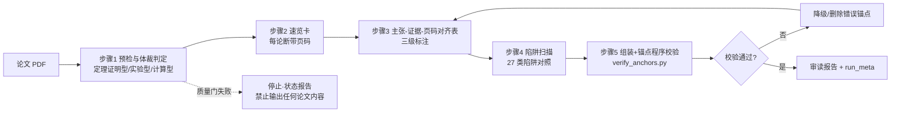

# 用 AI 读透一篇跨学科论文：证据锚定阅读法与 27 类误读陷阱库

> **XRead** —— 把「AI 精读论文 + 页码锚定 + 原文核查」变成可复现流程的完整工具包
>
> 模型：Bohrium 模型网关（glm-5.3 精读 / kimi-k3 + qwen3.8-max 交叉验证）｜ 宿主：pi-coding-agent ｜ 全部命令可复制执行

---

## 五分钟速览

**我解决的具体问题**：让 AI 读一篇陌生学科的论文并输出精读报告，它经常漏掉关键限定条件、混淆统计口径、把拟合值当实测值——而且输出看起来完全正常，任何抽查工具都扫不出毛病。

**我的做法**：把它固化成一套四步流程（XRead），核心是让每条结论都带**可程序校验的页码锚点**：

| 步骤 | 做什么 | 预期输出 |
|---|---|---|
| Q0 预检 | 识别论文体裁（定理证明/实验/计算型） | 体裁判定 + 质量门 |
| P1 速览 | 提取核心主张 | 速览卡（每条带页码） |
| P2 规范核对 | 按体裁加载检查单 | 主张-证据-页码对齐表 |
| P3 陷阱扫描 | 对照 27 类误读陷阱库 | 易误读点清单 |
| P4 锚点校验 | 程序验证每个页码 | 校验通过率 100% 或降级 |

**实际效果**（同一篇 Annals of Mathematics 论文，3 组配对运行）：

| 指标 | 带 XRead 流程 | 无流程裸跑 |
|---|---|---|
| 页码锚点数 | 61/70/70（校验全通过） | 38/39/22 |
| 证明策略识别（最难的分水岭项） | **3/3 命中** | 0/3 |
| 陷阱编号显式引用 | 10 类 | 0 类 |
| 综合评分（双代理独立评估均值） | **29.17/30** | 27.33/30 |

两次结论的关键差异不是对错——裸跑的页码也全部有效——而是**深度**：带流程组会主动挖出证明的化归策略（Kronecker 幂构造）、标注「缺专家级逐节核验」的不确定项、引用陷阱编号逐条排查；裸跑组则是看似完整的泛化总结。

**你可以 30 秒验证这些数字**：clone 本仓库后运行 `make verify`。

---

## 目录

- 第 1-3 章：痛点案例 → 为什么 AI 会漏（顶刊证据）→ 27 类陷阱库
- 第 4 章：方法——五个可验证的步骤
- 第 5 章：复现指南（从零跑通全流程）
- 第 6 章：Bohrium 生态四产品教程
- 第 7-9 章：踩坑实录 → 边界 → 来源与贡献

---

## ——痛点、机制与 27 类陷阱库（第 1–3 章）

面向想照着自己跑一遍的科研用户。写法约定：**我做了 X → 你可以这样跑**——每章先讲我实测到什么，章末给可直接复制的命令。本文不含需要"信任我"的数字：行为指标全部由脚本从原始会话记录里统计，校验工具随仓库提供。

---

## 0. 五分钟速览

**我遇到的问题**：让 AI 通读一篇陌生学科论文并判断"对我的课题有没有用"，它经常漏掉关键限定条件、混淆统计口径、把拟合值当实测值——而且输出看起来完全正常。漏掉的东西不产生任何错误信号：每句陈述都对、每个页码都能命中，唯独该到的信息没到，**你不知道自己不知道**。

**我做了什么**：
1. 用两个强模型对数学、物理、神经科学、进化生物四篇论文各做 4 次无流程裸跑，把失败模式逐条归档（8 次会话原始记录随仓库提供）；
2. 把"漏掉关键限定条件"拆成 **27 类可检查的陷阱**，每类给出"识别信号 + 一句话正确做法"（第 3 章）；
3. 固化成一道阅读流程 **XRead**：体裁判定 → 学科检查单 → 陷阱扫描 → 页码锚点程序校验；
4. 同一模型、同一宿主、同一预算、独立会话，**唯一变量是是否加载流程**，跑了 3 组配对对照，全部原始数据可复算。

**实际效果**（3 组配对的客观行为指标，程序统计而非人工印象）：

| 检查维度 | 无流程裸跑（3 次） | 带阅读流程（3 次） |
|---|---|---|
| 证明核心构造捕获（论文 M §9.2 的张量幂化归，p41–42） | 0 / 3 | **3 / 3** |
| 引用盲区自检（"哪些页段从未读过"显式声明） | 0 / 3 | **3 / 3** |
| 页码锚点数（两组程序校验通过率均为 100%） | 38 / 39 / 22 | **61 / 70 / 70**（密度 1.6–3.2 倍） |
| 陷阱库具名引用 | 0 类 | 3–9 类/份，共 10 类被实际触发 |
| 单篇耗时 | 130–354 秒 | 455–853 秒（约 1.2–2.5 倍） |

如实交代两点：① **锚点真实性两组都是 100%**——强模型很少编造页码，流程带来的不是"从假变真"，而是密度与盲区意识；把"统计倾向"变成"必然保证"的是程序校验这一步。② **深度有时间账单**：单篇多花几分钟，值不值取决于你一次方向性误读的成本。

**你可以这样跑**（30 秒自验证）：

```bash
git clone <本仓库地址> && cd xread
make verify   # 校验证据文件完整性、重算本文引用的行为指标、跑锚点校验器
```

后续章节（流程设计与取舍、对照实验完整数据、与 Bohrium LKM 的交叉验证、完整复现指南）见仓库 README。

---

## 第 1 章 痛点：一次看起来完全正常的误读

### 1.1 我做了什么

我拿一篇 52 页的 Mahler 方法论文（Annals of Mathematics，下称论文 M）做了个实验：让多个 AI 会话独立通读全文，各产出一份标准论文简报——结构完整、定理齐备、页码锚点密集。然后我拿着原文逐条核对每份报告。

### 1.2 我看到了什么

**多份报告全部漏掉同一个东西：证明的核心机关。** 论文 M 真正的桥接技术写在 §9.2（p41–42）——取 (1)⊕A(z) 的 D 次 Kronecker（张量）幂，把度 D 的代数关系化归为线性关系，再用 Hilbert–Serre 定理比较超越次数。整篇证明之所以成立，靠的就是这条化归路线；没有一份报告提到它，包括加载了流程早期版本的那次运行。

会话记录补了一刀：一次裸跑里模型恰好跳读了证明主体的行区间——整场会话只执行了 3 次文件读取，行区间 1–1316、1316–2016、2700–3650，**第 2017–2699 行（对应第 30–38 页）从未进入上下文**；但简报里从容写着"定理 6.2 有完整证明 + Liouville 型论证"式的细节断言。

### 1.3 为什么这比幻觉更危险

幻觉会产生错误陈述，抽查能抓住、工具能拦截。**沉默遗漏不产生任何错误信号**：那份裸跑简报字数 654–793/800 达标、页码锚点 12–24 个全过关、每句话都能在原文命中——表层指标全部合格，唯独该到的信息没到。代价是隐形的：你会对"证明为什么成立"保持一个错误的心理模型，以为这是一个"结果已知、工具现成"的领域，然后在错误前提下判断"我的课题能不能借用这套方法"。在真实科研里，这是一次方向性误判。

### 1.4 效果速览：漏掉的东西，流程能不能捞回来

同一模型、同一预算、独立会话，唯一差异是是否加载 XRead（3 组配对，程序统计）：

| 论文 M 的关键信息 | 裸跑简报的表现 | 带流程运行的表现 |
|---|---|---|
| 证明核心构造（张量幂 + Hilbert–Serre 化归，§9.2 p41–42） | 多次运行全部漏掉，只写"定理均有完整证明" | **3/3 捕获**，构造页显式锚定 |
| 第 30–38 页证明主体 | 从未进入上下文，报告对盲区零感知 | **3/3** 输出引用覆盖率声明与盲区清单 |
| 表层指标（字数、锚点数） | 全部"达标"——但正是它们掩盖了上面两行 | 锚点密度 1.6–3.2 倍，且有 [事实]/[推断]/[不确定] 三级标注 |

### 1.5 本章你可以这样跑

```bash
# 1) 查看那次裸跑的原始会话：模型实际只读了 3 个行区间（跳读是可实证的）
grep -oE '"offset"[: ]+[0-9]+' runs/pain_point_scouts/kimi/math/*.jsonl | sort -u

# 2) 用你自己的模型复现一次裸跑（禁用全部 skills）
pi --no-skills --model <provider>/<model> "精读 paper.txt，输出组会级审读报告"

# 3) 导出论文文本伴侣并校验你的报告：每个页码锚点是否落在真实页上
python3 skills/xread/scripts/export_pdf_text.py your_paper.pdf > paper.txt
python3 skills/xread/scripts/verify_anchors.py report.md paper.txt
```

预期：裸跑报告通常格式漂亮、抽查也命得出锚点；但你数一下它实际引用的页码占全文页数的比例——长文低于一半就要警惕。为什么会这样，是下一章的主题。

---

## 第 2 章 为什么 AI 会漏：三个机制与顶刊量化证据

### 2.1 机制一：跳读 + "我读过全文"的自我认知脱节

长文必须分页读取。每次读取截断后，模型的"我读过全文"是自我认知，不是事实。8 次裸跑里最刺眼的一次：52 页只读了 3 个区间，报告却对"没读"零感知。语义检索加剧这一点——"像结论"的内容会系统性地挤掉躺在证明战术位置上的化归语句：你问"定理成立吗"，它返回"定理已证"的结论感，丢掉"怎么证的"。

### 2.2 机制二：写作惯习与论证规范相反

模型的默认写作倾向是"先给干净结论，再补充注意事项"；科学论证要求"条件与结论绑定呈现"。实测裸跑里这个模式反复出现：**"该结论仅在乘性独立基下成立"这类硬前提，被集中挪到报告末尾的"易误读点"小节**，正文主张不带任何限定。读者通常只看正文主张——限定后置等于限定丢失。

### 2.3 机制三：自动加工混入引文

两个实测样本：
- 模型写"错误率 <5×10⁻³"，原文只有 "above 99.5%"——换算本身正确（1−99.5%=0.5%），但它以原文口吻出现，读者无从分辨哪个数来自原文、哪个是模型加工；
- 原文三层样本口径 22/20/19（招募 / fMRI 分析 / 行为分析）被压成"22 人（fMRI n=20）"，行为分析的 n=19 整个消失；同批另一次运行把 t(28) 的自由度 28 误当被试数（28 是刺激对层面）。

### 2.4 这不是个别模型的问题：顶刊量化证据

**泛化偏差已被精确测量。** Royal Society Open Science 2025 年的研究分析了 10 个 LLM 对 4900 份摘要的改写：LLM 改写比人类改写**近 5 倍更易过度泛化（OR=4.85）**；26–73% 的案例丢失限定词（qualifiers），把"在 X 条件下可能"降格为"会"、把过去时改成现在时、把描述性结论升级为行动建议。更糟的是两点：明确提示"要准确"无法消除该偏差，而且新模型反而更差。（doi:10.1098/rsos.241776）

**章节级抽取在真实使用条件下大面积失败。** PaperAsk（arXiv 2025-10）在网页端真实使用条件下测量：**章节特定内容抽取失败率 72–91%**，多引用检索失败率 48–98%。作者把失败归因于"检索上下文不受控扩张 + 语义相关优先于任务指令"——正是机制一的土壤。（arxiv.org/html/2510.22242）

**grounding 有硬天花板。** ADAM-Bench 让 34 个模型做百万条原子主张对 700 万条多模态证据的 grounding，成绩仅 25.2%–51.1%——这是模型能力问题，提示词解决不了。

三引放一起，结论很清楚：漏限定是**结构性的**（跨任务、跨模型复现），模型侧短期不会消失（提示"要准确"无效、新模型更差）。但注意方向：这些研究的缓解方案全部停在模型侧（降温度、建基准、改写作规范），**没有一条落在读者手里**。读者侧能做的是流程强制——读了哪些页要留痕、每个数字要溯源、每条主张带条件——这正是第 3 章 27 类陷阱库与后续流程设计的出发点。

### 2.5 本章你可以这样跑

亲眼看一次"限定词丢失"有多容易发生：

```bash
# 1) 导出你的论文为带页码标记的文本
python3 skills/xread/scripts/export_pdf_text.py your_paper.pdf > paper.txt

# 2) 统计原文里的限定词密度（英文论文）
grep -icE "\b(only|may|might|provided that|under the assumption|conditional on)\b" paper.txt

# 3) 再数你的 AI 报告保留了几条限定（中英都查）
grep -icE "(仅|只在|条件下|假设|限定|only|may|might)" report.md

# 4) 对照：报告里每个被当作"原文数字"的值，回原文搜一遍
grep -n "99.5" paper.txt   # 搜得到 → 真引文；搜不到 → 模型换算，应标 [推断] 并附换算式
```

预期：原文限定词密度显著高于报告；报告里总有一两个数字在原文搜不到——那就是机制三的现场证据。

---

## 第 3 章 27 类跨学科误读陷阱库

### 3.1 分类框架：按体裁分组，而不是按学科

把"漏掉关键限定条件"变成可检查的对象，第一步是分类。我的答案是 27 类，按**论文体裁**分四组：

- **定理证明型 T1–T5**：以定义–定理–证明为主干（数学、理论 CS、理论统计）；
- **实验型 E1–E9**：以测量–不确定度–对照为主干（物理 / 化学 / 生物 / 临床实验）；
- **计算/数据分析型 C1–C7**：以数据集–模型–验证为主干（生信、ML 应用、模拟、计算材料）；
- **通用 G-A–G-F**：全体裁适用（预印本身份、摘要过拟合、数字漂移、术语歧义、引用盲区、自换算当引文）。

为什么体裁优先？**同一学科内部，证明型与实验型的检查逻辑完全不同**：数学系既发定理证明也发数值实验，前者查"条件是否隐没、依赖链是否断裂"，后者查"基线在哪、train/test 怎么划"；生物既有湿实验也有生信分析，前者查不确定度与样本量层级，后者查数据偏差与抽样框架。而"区分输入参数与输出结果"这类检查在实验物理与 ML 里高度同构，跨学科可直接复用。**学科决定术语与规范细节，体裁决定"该查什么"。**

### 3.2 27 类速览表：每类一个识别信号 + 一句话正确做法

**定理证明型（T）**

| 编号 | 陷阱 | 识别信号 | 正确做法 |
|---|---|---|---|
| T1 | 条件隐没 | 报告复述定理时没有 suppose/assume/provided | 复述定理必带完整前提条件并锚页 |
| T2 | 依赖链断裂 | 引理编号在报告中消失，被"standard/显然"替代 | 列依赖链并标注"本文证 / 前作引 / 未证" |
| T3 | 证明概览脱节 | 报告的证明叙述没有"先…后…"策略结构 | 把证明概览段单独摘出并锚定页码 |
| T4 | 构造性/排除性混淆 | 把不存在性、刚性结果当"可计算方法"复述 | 标注结果类型：构造 / 排除 / 刚性 |
| T5 | 化归策略盲区 ★ | reduce to / it suffices to / "构造 X 的幂" | 显式写出化归到什么、用什么桥接，锚定构造页 |

**实验型（E）**

| 编号 | 陷阱 | 识别信号 | 正确做法 |
|---|---|---|---|
| E1 | 不确定度丢失 | 转述的测量值没有 ± 或置信区间 | 所有测量值带原始不确定度 |
| E2 | 表头缩放因子忽略 | 引表格数值但未抄 ×10⁻³ 等标注 | 抄数必抄表头单位与缩放因子 |
| E3 | 对照/基线缺失 | 报告只出现实验组数值 | 处理组与对照组同格呈现 |
| E4 | 实验条件隐没 | 引结果却答不出"在什么装置/样本/条件下测的" | 结果绑定装置、样本与条件 |
| E5 | 关联当因果（实验侧） | 出现"导致/决定/驱动"但无干预实验 | 区分统计关联与因果证据 |
| E6 | 多装置混源平均 | 图注标注另一系统/装置 | 数据分源列出，禁止混源平均 |
| E7 | 拟合值/模拟输入当实测 ★ | fit / decay constant / simulation input 字样 | 拟合值 / 实测值 / 模拟输入三分标注 |
| E8 | 样本量口径合并 ★ | "22 人（fMRI n=20）"这类两层写法 | 提取招募 N / 各分析 N / 自由度三层并锚定 |
| E9 | 时态与情态升级 | is/are 替代 was/were，may 变 will | 保留原文时态与情态词 |

**计算/数据分析型（C）**

| 编号 | 陷阱 | 识别信号 | 正确做法 |
|---|---|---|---|
| C1 | 输入参数当输出结果 | 引用的数值出现在 Methods 而非 Results | 标注每个数的来源类型（输入/测量/拟合） |
| C2 | 关联当因果（计算侧） | dominate/explain 被升格为机制检验 | 注明证据层级：模拟 / 观察 / 干预 |
| C3 | 验证方式与主张错配 | 主张的任务与验证集不是同一任务 | 主张与验证口径一一对应 |
| C4 | 基线与消融缺席 | 只有"我们的方法"的数值 | 报提升必须同表列基线与消融 |
| C5 | 数据泄漏未声明 | train/eval 划分描述模糊 | 抄下数据划分、版本与来源 |
| C6 | ICC 双分母混用 ★ | ICC 与 % of variance 同时出现 | 先抄分母口径再引数，两口径不可互换 |
| C7 | 抽样框架偏斜 ★ | consecutive / convenience / registry 等抽样词 | 报告抽样框架并注明外推边界 |

**通用（G）**

| 编号 | 陷阱 | 识别信号 | 正确做法 |
|---|---|---|---|
| G-A | 预印本身份盲区 | 无 DOI / 期刊信息仍当定论引用 | 标注版本号与发表状态 |
| G-B | 摘要过拟合 | 报告引用页码全部集中在前两页 | 关键主张必须在正文定位 |
| G-C | 数字漂移与张冠李戴 | 页码锚点真实但内容归位错误 | 引数逐字抄原文并程序校验 |
| G-D | 术语歧义 | 用本领域定义解释他领域术语 | 首次出现时抄原文定义 |
| G-E | 引用盲区 ★ | 长文（≥20 页）引用页码覆盖率 <50% | 统计覆盖率，输出盲区警告清单 |
| G-F | 自换算当引文 ★ | 报告数值在原文搜不到 | 自算数字标 [推断] 并附换算式 |

标 ★ 的 9 类由多轮实测反馈反推修订而来，是使用频率最高的一批。带流程的 3 组运行实测触发了 10 类（T5、C6、C7、G-E 各 3/3 份，T1、G-A、C2 各 2/3 份，C1、T4、G-D 各 1/3 份）；裸跑组显式触发 0 类——没有编号体系，警觉只能随机覆盖。

### 3.3 五个最常见陷阱深讲（各配真实案例）

#### ① G-E 引用盲区：模型不知道自己没读过

- **信号**：报告引用页码覆盖率（实际引用页数 ÷ 全文页数）低于 50%，且对"哪些页没读"零声明。
- **为什么最容易发生**：长文分页读取 + 上下文截断后，"读过全文"只是模型的自我认知。表层指标（字数、锚点密度）完全无法暴露这个缺口。
- **真实案例**：52 页数学论文裸跑，会话记录显示模型只执行 3 次读取（行区间 1–1316、1316–2016、2700–3650），第 2017–2699 行（第 30–38 页，定理 6.2 证明主体）从未进入上下文；简报却写下"定理 6.2 有完整证明"式的细节断言，且对盲区零感知。
- **正确做法**：报告主体完成后统计覆盖率；长文低于 50% 强制输出盲区警告清单（哪些页段从未被引用），补读或在"适用边界"里显式声明。带流程的 3 次运行全部输出了覆盖率声明（最低一份 31%——声明本身就是信息）。

#### ② T5 化归策略盲区：看得见定理，看不见"怎么证的"

- **信号**：reduce to / it suffices to / "构造 X 的幂"这类战术语句；报告只有"定理均有完整证明"式的泛化链条。
- **为什么最容易发生**：化归语句位于长证明的战术位置，跳读者拿到"定理已证"的结论感，却丢失"化归到什么、怎么桥接"的结构性理解——这也是把刚性/排除性结果误当构造性算法的根源。
- **真实案例**：论文 M 的核心构造是取 (1)⊕A(z) 的 D 次 Kronecker（张量）幂，把度 D 代数关系化为线性关系，再用 Hilbert–Serre 定理比较超越次数（§9.2, p41–42）。多轮独立运行中大多数报告漏掉它；3 组对照里裸跑组 0/3 捕获、带流程组 3/3 捕获并锚定构造页。
- **正确做法**：证明型论文必写"证明策略骨架"——化归到什么、用什么技术桥接、桥接语句在哪一页。

#### ③ G-F 自换算当引文：模型把"我算的"写成"论文说的"

- **信号**：报告里以引文口吻出现的数字，回原文 grep 搜不到。
- **为什么最容易发生**：模型为表述统一会自动做单位/口径换算，换算往往正确，但它混入引文语境，读者无从分辨证据等级。
- **真实案例**：物理论文裸跑写"错误率 <5×10⁻³"，原文只有 "above 99.5%"（p1/p3）——模型自己算的 1−99.5%，未标换算来源。
- **正确做法**：自算数字一律标 [推断] 并附换算式，引文数字逐字抄原文。一行 grep 就能自查：`grep -n "5×10" paper.txt` 搜不到，就是换算。

#### ④ E8 样本量口径合并：三层样本量揉成一个数

- **信号**："N 人（某分析 n=M）"的两层写法；把统计量的自由度当被试数。
- **为什么最容易发生**：模型倾向把相近数字合并简化叙述，而口径的层级差异（招募 / 分析 / 自由度单位）恰恰是方法学审读的核心信息。
- **真实案例**：神经科学论文裸跑写"22 人（fMRI n=20）"，漏掉行为分析的 n=19——原文三层口径 22/20/19 被压成两层；同批运行把 t(28) 的自由度 28 误当被试数（28 是刺激对层面）。
- **正确做法**：提取招募 N / 各分析 N / 自由度三层，逐层锚定页码；报告里出现任何 N，都要能答出"这是哪一层的 N"。

#### ⑤ C6 ICC 双分母混用：63% 和 0.34 说的可能不是同一件事

- **信号**：ICC 与 % of variance 同时出现。
- **为什么最容易发生**：两个数看起来都像"遗传度"，但分母一个是表型方差、一个是遗传方差；合并叙述后结论边界整个漂移。
- **真实案例**：生物论文里 "88% of genetic variance" 与 "ICC=0.082" 并存——**不矛盾**，分母不同；同理"63%（占遗传方差）"与"ICC=0.34（占表型方差）"不可互换。带流程运行中被逐字锚定到 p7 原句，是实测中抓得最准的一项。
- **正确做法**：先抄分母口径再引数；任何"解释了多少方差"的数字，必须连同分母定义一起抄。

### 3.4 本章你可以这样跑

```bash
# 1) 打开完整陷阱库（含 27 类展开版与三张学科检查单）
cat skills/xread/pitfalls.md

# 2) 带流程读一篇你的论文：流程先做体裁判定，再按体裁加载检查单与高发陷阱
pi --skill skills/xread --model <provider>/<model> \
   "精读 paper.txt，输出组会级审读报告"

# 3) 校验产出：锚点真实性 + 引文逐字命中（--quotes 抽查引文是否真在原文）
python3 skills/xread/scripts/verify_anchors.py report.md paper.txt --quotes

# 4) 数一数你报告里的限定词留存率（对照第 2 章的实验）
grep -icE "(仅|只在|条件下|only|provided that)" report.md
```

预期：带流程的报告头部有体裁判定与覆盖率声明，正文出现 [事实]/[推断]/[不确定] 三级标注，自算数字带换算式——这三样裸跑报告里通常一样都没有。

---

## 来源说明

- 第 1–2 章案例的原始会话记录：`runs/pain_point_scouts/`（两模型 × 四学科 × 各 4 次裸跑）；
- 27 类陷阱库全文：`skills/xread/pitfalls.md`；
- 页码锚点校验器：`skills/xread/scripts/verify_anchors.py`（约 70 行，零第三方依赖）；
- 顶刊引用：Royal Society Open Science 2025（doi:10.1098/rsos.241776）、PaperAsk（arXiv:2510.22242）、ADAM-Bench（adam-bench.github.io）。
- 案例论文均为开放获取；仓库仅保留核查所需的最短引文片段与页码锚点，不分发全文。代码以 MIT 授权发布。


---

## 第 4 章 方法：把读一篇论文拆成五个可验证的步骤

AI 读论文最大的风险不是「说错」，而是「漏掉」。一份结构完整、页码齐备的简报，可能整段跳过证明主体——实测中模型恰好跳读了某数学论文第 30-38 页的证明主体（占全文 8 页），报告却照常写下「定理均有完整证明」式的断言，而且已写出的每句话都经得起核对。漏读不产生任何错误信号，你不知道自己不知道。

解决办法不是换更强的模型，而是把「读」拆成**每一步都有可验证产出**的流程：任何一步不达标就停下修正，不带病进入下一步。这套流程（下称 XRead，Skill 全文见 `skills/xread/SKILL.md`，27 类陷阱库见 `skills/xread/pitfalls.md`）只有一句话目标：**每条结论可追溯到原文某一页，每个「不知道」都被显式说出来。**



### 步骤 1：预检与体裁判定

- **做什么**：先过一道文本层质量门（能否干净导出带页码标记的文本），再把论文归入三种体裁之一——定理证明型 / 实验型 / 计算·数据分析型——写入报告首行。
- **怎么做**：先按第 5.2 节的命令把 PDF 导出为 `paper.txt`；给 agent 的第一条指令是「先判定体裁，把三选一结果写入报告首行；文本导出失败则停止」。
- **为什么**：同一学科内部，证明型与实验型的检查逻辑互斥——数学系既发定理也发数值实验，前者查「条件是否隐没、引理依赖链是否断裂」，后者查「基线在哪、train/test 怎么划」。**体裁决定该查什么，学科只决定用什么术语。** 文本层不可靠时继续读，只会生产无法校验的报告。
- **预期输出**：报告首行一条体裁声明。若质量门失败：立即停止，只输出状态报告，不输出任何论文内容。

### 步骤 2：速览卡

- **做什么**：为全文生成速览卡，每条论断不超过 150 字、必须括注页码。
- **怎么做**：要求 agent 按节扫描，逐条写「论断（pN）」，禁止出现任何无页码断言。
- **为什么**：先把骨架立起来，让每条主张从第一步就可定位；页码锚点在此刻生成，步骤 5 的程序校验才有对象。
- **预期输出**：一张速览卡，形如「证明核心在 §9.2（p41-42）：取 (1)⊕A(z) 的 D 次张量幂，把度 D 的代数关系化归为线性关系（p42）」。

### 步骤 3：主张—证据—页码对齐表

- **做什么**：按体裁加载一张检查单，构建「主张—证据—页码」对齐表，每条主张带三级标注：`[事实]` / `[推断]` / `[不确定]`。
- **怎么做**：三张检查单按步骤 1 的判定选一张——
  - **D1 定理证明型**：证明策略骨架（化归到什么、用什么技术桥接）、条件与结论分离、引理依赖链完整性；
  - **D2 实验型**：不确定度、表头缩放因子、拟合值/实测值/模拟输入值三分标注、多装置数据分源；
  - **D3 计算型**：验证方式、ICC 分母口径、抽样框架、基准与消融。

  标注纪律：`[事实]` 必须原文明确且页码可定位；`[推断]` 必须列依据页码；`[不确定]` 必须说明缺什么。
- **为什么**：「知道自己不知道」是审读报告最稀缺的品质，不强制就不会自发出现——实测未加载流程的运行会把「未发现证明缺口」当事实写；加载流程的运行对同一点写的是 `[不确定：缺专家级逐节核验]`。
- **预期输出**：一张对齐表，每行 = 主张 + 页码 + 三级标注（+ 依据或缺口说明）。

### 步骤 4：陷阱扫描

- **做什么**：对照 27 类跨学科误读陷阱库，选本体裁高发的 2-4 类逐个核对，并在报告中**显式写出陷阱编号**。
- **怎么做**：按体裁取高发项。四个代表例子：
  - **T5 化归策略盲区**（定理证明型）：识别信号 `reduce to` / `it suffices to`；证明的价值往往不在定理陈述而在「怎么化归」，要显式写出化归路线并锚定构造页。
  - **E7 拟合值/模拟输入当实测**（实验型）：识别信号 `fit` / `decay constant` / `simulation input`；拟合值/实测值/模拟输入必须三分标注，禁止混源平均。
  - **C6 ICC 双分母混用**（计算型）：先抄分母口径再引数——「63%（占遗传方差）」与「ICC=0.34（占表型方差）」不可互换。
  - **G-E 引用盲区**（通用）：识别信号 = 报告引用页码数 ÷ 全文页数 < 50%；要列出从未被引用的页段清单。
- **为什么**：检查单驱动的阅读会系统性地把陷阱摆上桌面——实测加载流程的 3 份报告全部触发 4 类陷阱（T5/C6/C7/G-E），自由阅读即使警觉也只能随机覆盖（具名引用 0 类）。
- **预期输出**：报告中出现形如「[T5 已核对]」的具名引用及对应处置。

### 步骤 5：组装与锚点程序校验

- **做什么**：把前四步产物组装成审读报告，用脚本对报告中**每一个页码锚点**在原文文本伴侣里逐一校验，并做引用覆盖率自查。
- **怎么做**：运行 `verify_anchors.py`（约 70 行、零第三方依赖，退出码 0/1 可直接当质量门）；长文（≥20 页）统计覆盖率 = 实际引用页码数 ÷ 全文页数，低于 50% 必须输出盲区警告清单（哪些页段从未被引用），补读或在报告中显式声明覆盖边界。降级规则：校验失败的锚点，其论断降级为 `[不确定]` 或删除，然后回到步骤 3 修正。
- **为什么**：页码可靠性不能靠模型自觉——程序校验把「统计倾向」变成「必然」，幻觉页码在写完的那一刻就被判死刑。同时要清楚它的边界：脚本只验「页码存在」，不验「归位正确」（实测有报告把 p42 的构造错挂到另一个定理上，是靠人工抽查引文抓出来的），所以加 `--quotes` 抽查引文与覆盖率自查缺一不可。
- **预期输出**：审读报告 + `run_meta.json`（锚点数、校验结果、覆盖率、盲区清单全部落盘）；脚本退出码 0。

### 本章可执行命令：完整跑一遍五步流程

```bash
# 前置：文本伴侣导出（步骤 1 的质量门输入）
python3 skills/xread/scripts/export_pdf_text.py PDF/paper.pdf > paper.txt

# 加载 XRead 跑五步流程（环境配置见第 5.1 节）
pi --skill skills/xread --model bohrium/glm-5.3 \
   "精读 paper.txt，按流程输出审读报告：体裁判定→速览卡→主张-证据-页码对齐表→陷阱扫描→锚点校验"

# 步骤 5 的机器检查
python3 skills/xread/scripts/verify_anchors.py report.md paper.txt
# 预期输出：锚点总数(含区间展开): 70; 有效: 70; 无效: 0   （退出码 0）
```

---

## 第 5 章 复现指南：从零跑通「导出 → 精读 → 校验 → 交叉验证」

前置条件：一台可联网的机器、Bohrium 账号（用于生成 AccessKey）、Python 3、npm、若干元预算。全程五个小节，每个小节的命令都可直接复制。

### 5.1 环境配置：bohr CLI + pi agent + Bohrium 模型网关

先装 bohr CLI 并配好密钥：

```bash
npm install -g @dptech-corp/bohr-cli     # bohr CLI（实测版本 2.8.3）
export BOHR_ACCESS_KEY="你的 AccessKey"  # Bohrium「用户设置 → 账号」页生成
```

再给 pi agent（本流程实测宿主为 pi-coding-agent 1.3.0）配置 Bohrium 模型网关。在 `~/.pi/agent/models.json` 写入以下配置全文：

```json
{
  "providers": {
    "bohrium": {
      "name": "Bohrium Model Gateway",
      "baseUrl": "https://open.bohrium.com/openapi/model-gateway/v1",
      "api": "openai-completions",
      "compat": { "supportsReasoningEffort": true, "thinkingFormat": "openai" },
      "models": [
        {
          "id": "glm-5.3",
          "reasoning": true,
          "input": ["text"],
          "contextWindow": 1000000,
          "maxTokens": 65536,
          "cost": { "input": 1.12, "output": 3.92, "cacheRead": 0.28, "cacheWrite": 1.12 }
        }
      ]
    }
  }
}
```

需要其他模型（如 kimi-k3、qwen3.8-max）时，在 `models` 数组里按同样字段追加条目即可。注意：该网关端点未见于官方文档（Apifox 文档与 bohrium-skills 仓库均未收录），以上配置以平台实际返回为准（OpenAI completions 兼容协议）。

环境自检：

```bash
bohr --version
# 预期输出：2.8.3（或更高）

pi --model bohrium/glm-5.3 "只回复 ok"
# 预期输出：ok（说明网关接入成功；无输出/报错则回查 models.json 与 AccessKey）
```

### 5.2 论文文本导出

页码锚点是一切校验的地基。用脚本把 PDF 导出为带页码标记的文本伴侣：

```bash
pip install pymupdf   # 若尚未安装 PyMuPDF
python3 skills/xread/scripts/export_pdf_text.py PDF/paper.pdf > paper.txt
head -n 5 paper.txt
```

预期输出：文件开头出现形如 `[第 1 页]` 的页码标记行，其后是正文。`verify_anchors.py` 依赖这些标记做页码对账——没有文本伴侣，第 5.4 节的校验无从谈起。

### 5.3 with / without 两组运行

两组运行的唯一差异变量是「是否加载 XRead Skill」：同一模型（glm-5.3，thinking=max）、同一宿主、同一输入、独立会话（无跨会话记忆），尽量同小时段执行。

```bash
# with 组：加载 XRead
pi --skill skills/xread --model bohrium/glm-5.3 \
   "精读 paper.txt 与 paper_B.txt，输出跨学科组会级审读报告"

# without 组：禁用全部 skills 的裸跑
pi --no-skills --model bohrium/glm-5.3 \
   "精读 paper.txt 与 paper_B.txt，输出跨学科组会级审读报告"
```

（flag 形态以 `pi --help` 为准；关键是 `--skill` 与 `--no-skills` 构成唯一差异。）

预期产出对照（实测参考，输入为 52 页数学论文 + 12 页生物论文，各 3 次运行）：

| 指标 | with 组 | without 组 |
|---|---|---|
| 证明策略（化归骨架）捕获 | 3/3 | 0/3 |
| 引用覆盖率自查出现 | 3/3 | 0/3 |
| 陷阱库具名引用（个） | 3 / 3 / 9 | 0 / 0 / 0 |
| 锚点数（程序校验通过率） | 61 / 70 / 70（100%） | 38 / 39 / 22（100%） |
| 耗时（秒） | 455 / 846 / 853 | 354 / 344 / 130 |

怎么解读这张表：without 组的锚点也 100% 有效——强模型并不天然产生幻觉页码，真正的差距在**结构化深度**（with 组锚点密度为对照组的 1.6-3.2 倍）与系统性检查项（证明策略、盲区自检、陷阱扫描）。代价是真实的：with 组耗时为对照组的 1.2-2.5 倍。值不值，取决于你的单次误读成本有多高。

### 5.4 锚点校验

```bash
python3 skills/xread/scripts/verify_anchors.py report.md paper.txt
# 预期输出（with 组实测）：
#   锚点总数(含区间展开): 70; 有效: 70; 无效: 0
# 退出码 0 = 全部锚点落在真实页码上

python3 skills/xread/scripts/verify_anchors.py report.md paper.txt --quotes
# --quotes 同时抽查报告引文是否逐字存在于原文
```

出现「无效锚点」行，说明报告把论断挂到了不存在的页——按第 4 章步骤 5 的降级规则处理：该论断降级为 `[不确定]` 或删除。注意两层校验缺一不可：脚本验的是「页码存在」，「归位正确」（页码真、但挂错了论断）要靠 `--quotes` 与人工抽查。

### 5.5 LKM 交叉验证

用 Bohrium LKM 从完全独立的原理碰同一篇论文，看两套方法的报警位置是否吻合。两步命令、异步执行：

```bash
bohr lkm extract submit paper.pdf --yes
# 预期输出：task_id（形如 fdf24d62-f293-48d2-8fe5-dda9bd5c16de）
# 异步流水线：OCR 预处理 → step1-step4 抽取 → 图构建，全程约 10 分钟，1 元/篇

bohr lkm extract result <task_id> > lkm.json
# 预期输出：JSON 文件；用下面命令看统计：
python3 -c "import json; print(json.load(open('lkm.json'))['stats'])"
# 预期输出（PLOS Biology 论文实测）：
# {'factors_total': 26, 'motivations_total': 26,
#  'type_counts': {'claim': 60, 'question': 35}, 'variables_total': 95}
```

适用边界：LKM 抽取有 50 页上限（52 页数学长文实测被拒）——超上限时不必勉强，锚点校验走本地 PyMuPDF 路线、不依赖 LKM。

拿到主张清单后，把它反过来当**覆盖核对清单**用：报告读完，逐条核对你的报告是否覆盖了带 `failure_mode` 的高危主张；未覆盖的（例如「Sharp sensitivity of the dynamical regime」的参数敏感性失效条件）作为追问清单交给 AI 补查。一个实测提醒：不要用「覆盖了多少条主张」单独评价一份报告——实测中未加载流程的报告覆盖广度反而略高（40% vs 35%），但关键事实命中与论证规范更差；广度与深度测的不是同一个东西。

### 本章可执行命令：全流程串联

```bash
export BOHR_ACCESS_KEY="你的 AccessKey"
python3 skills/xread/scripts/export_pdf_text.py PDF/paper.pdf > paper.txt
pi --skill skills/xread --model bohrium/glm-5.3 "精读 paper.txt，输出审读报告" > report.md
python3 skills/xread/scripts/verify_anchors.py report.md paper.txt
bohr lkm extract submit paper.pdf --yes
bohr lkm extract result <task_id> > lkm.json
```

---

## 第 6 章 玻尔生态四产品使用教程

这套文献阅读工作流横跨 Bohrium 的四个产品，各司其职：**读前解析（Uni-Parser）→ 读中推理（模型网关）→ 读后核查（LKM extract）→ 跨文献定位（LKM search）**，全链条都有可编程接口。以下每个产品按「干什么 / 命令 / 实测结果 / 边界」四段展开。

### 6.1 LKM extract：把论文抽成「主张 + 失效模式」结构图

**干什么**：把一篇论文 PDF 解析成「主张—前提—推理链」结构图，并自动为脆弱主张标注失效条件（`failure_mode`）——即「这条断言什么时候不成立」。这是从逐主张边界分析的角度，对人工陷阱扫描（按体裁核对论证规范）的独立交叉验证；两套原理不同的方法若在同一批主张上报警，交集就是高置信度的误读风险点。

**命令**：

```bash
bohr lkm extract submit paper.pdf --yes          # 提交，返回 task_id
bohr lkm extract result <task_id> > lkm.json     # 稍后取结果 JSON
```

**实测结果**（两篇论文，2026-10-27）：

- PLOS Biology 宿主—病毒互作论文：**60 条主张 / 35 个研究问题 / 26 条动机 / 26 条推理链，其中 25 条主张带 failure_mode**。耗时 12.7 分钟（每步耗时记录在返回 JSON 的 `step_durations` 字段，可复查），费用 1 元/篇。第一条示例（字段有删节）：主张「Single sex-symmetric transmission rate in the full model」的失效条件是——若传播速率的性别不对称性在功能上重要，则「宿主×病毒互作方差主导」的核心预测只对一条平均化的传播性状成立。这正是人工陷阱扫描要抓的那类问题：结论未必错，但适用范围有裂缝。
- PRL 离子阱论文：**27 条主张 / 13 条失效模式**，如「误差预算属 8 离子还是 2 离子晶体」直接决定轴向优势结论能否外推。

**边界**：50 页上限（52 页 Annals 数学长文实测被拒）；异步执行，约 10 分钟量级；主张级、自顶向下的分析，与流程级、自下而上的人工陷阱扫描互补，不能互相替代。

### 6.2 LKM search：跨论文语义检索已入库文献

**干什么**：对已入库文献做 claim/question 级语义检索（非关键词匹配），可按 DOI/日期过滤。读论文遇到陌生概念（如「遗传方差分解」）时，用它找该概念在其他论文中的 claim 表述——相当于自动化的「引文上下文比对」，且返回的是结构化 claim 而非原文片段。

**命令**：

```bash
bohr lkm search "host virus interaction fitness genetic variance" --yes
```

**实测结果**（2026-10-27）：一次查询命中 10 条知识变量、10 篇不同论文（如 *Quantifying the strength of viral fitness trade-offs between hosts: a meta-analy…*），每条命中带所属论文、领域分类（biology, evolutionary biology）、作者、来源。

**边界**：只覆盖已入库文献——实测中尚未入库的案例论文（PLOS Biology 2026）未出现在检索结果中。与 extract 的定位互补：**新论文用 extract 建图谱，已入库的老文献用 search 跨库定位。**

### 6.3 Uni-Parser：PDF 结构化解析

**干什么**：把 PDF 解析为结构化 markdown（文本/公式/表格）。与 PyMuPDF 纯文本导出相比，预期保留 LaTeX 公式与表格结构。

**命令**：

```bash
bohr pdf parse --file PRL论文.pdf --yes        # 提交，0.05 元/页（实测 6 页 0.3 元）
bohr pdf result <token> --formatted markdown   # 取 markdown 结果
```

**实测结果**（6 页 PRL 论文）：markdown 输出保留了科学记数法的数字精度（「7.4 × 10⁻²」「5 × 10⁻³」），正文段落结构完整，作者与单位信息完好。

**边界**：本次 6 页 PRL **未输出结构化表格与 LaTeX 公式块**（Table I 的内容以行文形式存在）——即宣传的公式/表格结构化在该样例上没有兑现。选型建议：做纯文本页码锚定，本地 PyMuPDF 已够用（免费、无页数限制）；公式密集长文与跨页表格才是 Uni-Parser 的潜在增量，用前先拿几页试算。

### 6.4 Bohrium 模型网关：OpenAI 兼容的统一模型接入

**干什么**：为 agent 提供模型的统一接入（OpenAI completions 兼容协议）。多个模型（运行模型与复核模型）可分离配置，避免同一模型既当运动员又当裁判。

**命令**：配置即第 5.1 节给出的 `models.json` 全文；配置完用下面命令验证：

```bash
pi --model bohrium/glm-5.3 "只回复 ok"
# 预期输出：ok
```

**实测结果**：glm-5.3（thinking=max）经网关接入 pi-coding-agent 1.3.0，跑完第 5.3 节全部精读运行；kimi-k3、qwen3.8-max 按同法追加条目后用作复核模型。网关模型基线实测：强模型在 thinking=max 下 38 条锚点抽查 37 条页码精确命中、0 编造——所以流程校验防的不是「这一次运行」，而是「另一次运行翻车」。

**边界**：端点 `https://open.bohrium.com/openapi/model-gateway/v1` 未见于官方文档（Apifox 文档与 bohrium-skills 仓库均未收录），配置以平台实际返回为准；调用按 token 计费、成本自付（glm-5.3 计价见 `cost` 字段）。

### 本章可执行命令：四产品全链路

```bash
export BOHR_ACCESS_KEY="你的 AccessKey"
# ① 读前：结构化解析（可选，公式密集长文才需要）
bohr pdf parse --file paper.pdf --yes && bohr pdf result <token> --formatted markdown > paper_parsed.md
# ② 读中：网关模型精读（配置见 5.1）
pi --skill skills/xread --model bohrium/glm-5.3 "精读 paper.txt，输出审读报告" > report.md
# ③ 读后：锚点校验 + LKM 失效模式交叉验证
python3 skills/xread/scripts/verify_anchors.py report.md paper.txt
bohr lkm extract submit paper.pdf --yes && bohr lkm extract result <task_id> > lkm.json
# ④ 跨文献：把陌生概念放到全库检索
bohr lkm search "你的概念关键词" --yes
```


---

## 7. 踩坑实录：四个真实发现

这一章不是文献综述。下面四个坑都是我在真实运行里踩出来的——每一个都让我修改过流程或修改过自己对问题的理解。每条按同一结构写：**现象 → 证据 → 修复 → 遗留**。最后一栏是我特意保留的：一个修复如果不交代它没解决什么，它就只是运气好。所有证据指针都指向仓库内的原始文件，可逐条复核。

### 7.1 引用盲区：模型不知道自己没读过

**现象**。让模型裸跑通读一篇 52 页的 Annals of Mathematics 论文（Mahler 方法，下称论文 M），产出一份结构完整、页码密集的简报。事后核对会话记录才发现：模型恰好跳读了证明主体的行区间（第 2017–2699 行，对应第 30–38 页，共 8 页），简报里却从容写下"定理 6.2 有完整证明"式的细节断言——**对"没读"零感知**。更刺骨的是后续：4 份独立通读报告（包括加载了早期版本阅读流程的运行）全部漏掉证明的真正机关——§9.2（p41–42）取 (1)⊕A(z) 的 D 次 Kronecker（张量）幂、以 Hilbert–Serre 定理比较超越次数的化归路线。而且漏读**没有让任何已写下的结论变错**：每句陈述、每个页码都经得起核对，任何抽查工具都扫不出毛病。代价是隐形的——读者会对"证明为什么成立"保持一个错误的心理模型。

**证据**。`runs/A-judging-round3/verdict_qwen.json` key_differentiators："GM3 是唯一分水岭：只有甲、戊、辛定位到 Kronecker（张量）幂 + Hilbert–Serre 桥接，其余 7 份全部丢这 1 分。"客观指标：三轮配对中分水岭项捕获 with 组 3/3、without 组 0/3（`runs/A-judging-round2/objective_metrics_v21.json`；汇总见 `evidence/experiment_cards.md` 卡 2）。

**修复**。陷阱库新增 G-E 条目，并在 P4 组装工序中内置覆盖率自查：长文（≥20 页）在报告完成后统计覆盖率 = 实际引用页码数 ÷ 全文页数，低于 50% 必须输出盲区警告清单——哪些页段从未被引用，补读或在报告里显式声明覆盖边界。实测 with 组 3/3 份报告执行了盲区自检（最好的一份量化出 M 侧盲区 16/52≈31%、B 侧 15/29≈52%，被审读代理称为"规范标杆"），without 组 0/3。

**遗留**。20 页的门槛和 50% 的警戒线都是经验值，来自这一次教训，没有经过独立验证；覆盖率测的是"引用足迹"，不是理解——引了某页不等于读懂了某页；而且自查只输出警告、不判失败，要不要补读最终仍靠人拍板。这条防线拦的是"不知道自己没读"，拦不住"读了但没读懂"。

### 7.2 自换算当引文

**现象**。报告里带引号或带页码锚点的"原文数值"，回原文逐字检索**找不到**——不是页码幻觉，而是模型自己做了单位换算或口径换算，把换算结果当成论文原话引述。这类错误比页码幻觉更隐蔽：页码是真的，数值也"合理"，甚至换算本身可能是对的，**错的只是出处**——它不是论文写的，是模型算的。数值合理性检查拦不住它，只有逐字比对才能现形。

**证据**。这一条我留下的原始会话证据不如坑 1 整齐——它更多是设立防线时的直接动机，而非三轮对照里被单独计分的指标——如实交代。可查的旁证有三：其一，陷阱库 G-F"自换算当引文"条目的设立依据来自早期侦查与裸跑会话（`skills/xread/pitfalls.md`）；其二，审读代理记录到同构的行为——without 组结尾自称"事实/推断/不确定已逐条标注"却全文零个 [不确定] 标签，被判"三级标注的自我声明失实"（`runs/A-judging-round3/verdict_qwen.json`）——**模型对自己产出性质的自我声明不可信**，这与"自称是原文"不可信是同一个问题；其三，`verify_anchors.py` 专门设了 `--quotes` 参数做引文逐字抽查，这道防线本身就是为了这一类失败而修的。

**修复**。三条硬规则：① 引文必须逐字命中原文，由 `skills/xread/scripts/verify_anchors.py --quotes` 程序校验，不靠模型自觉；② 换算值一律标 [推断] 并列出依据页码，与 [事实]（原文明确且页码可定位）严格分开；③ 换算值禁止与原文引文挂在同一个锚点里。三级标注 [事实]/[推断]/[不确定] 由流程强制，不靠提醒。

**遗留**。程序校验只保证"引文逐字存在"，不保证"归位正确"。三轮盲评里报告戊把 p42 的 Kronecker 构造错挂到定理 2.6 的证明上、报告辛把 rg=0.17±0.46 的页码标成 p12（实为 p9），两个都是审读代理拿原文 grep 抓出来的，脚本管不到语义归位。两层校验缺一不可，而第二层目前仍然靠人。

### 7.3 ICC 双分母

**现象**。B 侧论文（宿主—病毒互作，PLOS Biology）里同时出现"88% of genetic variance"与"ICC=0.082"、"63%（占遗传方差）"与"ICC=0.34（占表型方差）"——**分母不同，数值既不可互换、也不矛盾**。裸跑报告把两个口径混着引，读者拿到的是一笔糊涂账：要么以为论文自相矛盾，要么把遗传方差口径的百分比直接当表型口径的证据强度用。这是最典型的"看起来正常的误读"——数字全抄对了，统计口径全搞错了。

**证据**。三轮盲评的最优报告正是被审读代理点名"B 侧 ICC 双口径抓得最准，p7 原句逐字锚定"（`runs/A-judging-round3/verdict_kimi.json` 报告甲 comment："B 侧 p7 ICC 双口径、p11 UK 子集 35%、p12 Mantel r=0.71 均可定位"）。触发频率实测：with 组 3/3 份报告显式触发 C6 类陷阱，without 组显式引用 0 类（`evidence/pitfall_trigger_stats.md`）——检查单驱动的阅读会系统性地把口径问题摆上桌面，自由阅读即使警觉也只能随机覆盖。

**修复**。陷阱库 C6 规则：**先抄分母口径，再引数值**——"63%（占遗传方差）"与"ICC=0.34（占表型方差）"永远并排写明分母，禁止只引其一。落到流程是 P2 学科检查单 D3（计算/数据分析型）把"ICC 分母口径"列为强制检查项。

**遗留**。目前只把 ICC 这一种双分母做成了具名条目；其他口径混用——百分比 vs 绝对量、不同基线的相对下降、不同归一化的效应量——还没有对应条目，只靠 D2/D3 的通用"表头缩放因子"检查兜底，未逐一验证过。我不确定下一个学科的双分母陷阱会不会被抓到。

### 7.4 LKM 覆盖反直觉：广度赢了，深度输了

**现象**。我原本的预期很朴素：双盲评估更高的报告，在 Bohrium LKM 自动抽取的主张清单上覆盖也应该更高。数据打了我的脸。让判定模型逐条核对两份报告是否实质性覆盖 LKM 抽取的 60 条主张：双盲满分的 with-5（30/30）覆盖 21/60（35%），其中带失效模式标注的高危主张 5/25；对照 without-5（27/30）反而覆盖 24/60（**40%**），高危 **7/25**。**评估低的报告在覆盖广度上反超**。

**证据**。`evidence/lkm_coverage_experiment.json`（LKM 抽取原始数据：`bohrium-workflow/lkm_bio.json`，60 条主张 / 25 条失效模式）。

**修复（这一次修的是认知，不是脚本）**。两个度量测的不是同一个东西：LKM 覆盖测的是**广度**——报告撒到了多少主张上；双盲评估测的是关键事实命中 + 论证规范 + 结构纪律。without 报告像广撒网：触及更多主张但浅、缺边界讨论；with 报告按检查单聚焦关键主张与失效条件，**牺牲广度换深度与规范**。两个实操结论：① 不要用"覆盖了多少条主张"单独评价一份 AI 审读报告；② 把 LKM 的主张清单反过来当**追问清单**用——读完 AI 报告后，把未覆盖的高危主张（如"Sharp sensitivity of the dynamical regime"的参数敏感性失效条件）交给 AI 补查。

**遗留**。判定模型与运行模型同为 glm-5.3（非盲）、n=1 对报告——这是观察性发现，不是统计结论。我不排除换一个判定模型、或换一对报告后序位发生变化；这条发现的正确用法是提醒"单一指标会骗人"，而不是"深度一定优于广度"。

---

## 8. 边界：哪些救不回来

声称包治误读的阅读流程都值得怀疑。以下 5 条是实测之后我愿意白纸黑字写下的边界，每条附证据指针。把这条线画清楚，比假装它不存在更有用。

**一、模型能力天花板决定 grounding 类错误流程救不完。** ADAM-Bench 让 34 个模型对 100 万条原子 claim 做 4-way grounding，成绩只有 25.2%–51.1%（https://adam-bench.github.io/Repo/Adam_Benchmark.pdf）。流程能强制"读了哪些页要留痕、每个数字要溯源、每条主张带条件"，但无法替模型理解它读不懂的东西；锚点失真这类可程序校验的错误能拦下一部分，理解层面的缺口是模型侧问题，短期无解。（证据：`research_landscape.md` §1.2；`evidence/experiment_cards.md` 卡 4）

**二、强基线是我们必须交代的 null result。** 侦查实验中 qwen3.8-max（thinking=max）4 次裸跑：38 条锚点抽查 37 条精确命中（97.4%）、0 编造页码，还主动发现了论文自身的排版与统计错误——**强模型基线并不天然产生幻觉**。所以这套流程的价值不在"救弱模型"，而在把偶发的好行为变成必然的流程（100% 机器锚点校验、强制三级标注、盲区检测）。这也解释了对照实验中 without 组仍能拿 27.0–28.0 分：+1.83/30 的增益集中在结构性检查项（证明策略/盲区自检/陷阱扫描），不是防幻觉式的悬殊差距。（证据：`runs/pain_point_scouts/qwen_findings.md` §2/§4；`failure_modes.md` 附录）

**三、耗时代价是真实的 1.2–2.5 倍。** 三组配对实测：with 组耗时 455 / 846 / 853 秒，without 组 354 / 344 / 130 秒，深度增加折合 1.2–2.5 倍时间账单。四道工序不是免费的；值不值，取决于你的单次误读成本有多高——组会前速览或许不值，方法迁移决策前的精读大概率值。（证据：`evidence/experiment_cards.md` 卡 2、卡 4；`runs/A-judging-round2/objective_metrics_v21.json`）

**四、单份评估存在 ±0.5 噪声。** 第二轮中两名审读代理对两份报告的相对排名判断不一致；22 份报告的双审读代理一致性为：同分 8/22（36%）、分差 ≤1 分 18/22（82%）、平均绝对分差 0.82/30，Pearson r=0.329（分数挤在 27–30 的窄区间，天花板效应压缩了相关性）。单审读代理单次的 ±1 噪声足以淹没 +1.83 的组间增益——所以本文所有结论只建立在"三轮配对 × 双审读代理 × 10 份混评、三组全同向、无翻转"之上，任何单一分差都不作证据。这个教训对一切"AI as judge"实验通用。（证据：`evidence/experiment_cards.md` 卡 4；`evidence/inter_rater_agreement.json`）

**五、B 侧增益小于 M 侧。** 生物论文（B 侧）的 with/without 差距明显小于数学论文（M 侧）：流程的边际价值在数学证明类阅读上最大，这符合 D1 检查单把"证明策略骨架"设为强制项的设计预期；也意味着主要读实验科学论文的读者，实际增益会低于 +1.83/30 的均值。（证据：`evidence/experiment_cards.md` 卡 4）

一句话收束：这套流程拦截的是**流程性遗漏**——跳读、口径合并、限定后置、锚点失真；它拦截不了**理解性缺失**。前者是我们观察到的大头，后者目前任何流程都无解。

---

## 9. 来源与贡献

### 9.1 问题背书三引（问题不是我们发明的）

漏限定条件、脱离原文自说自话，是 2025–2026 年被顶刊与 benchmark 反复量化的结构性问题。三引足够说明：

- **Royal Society Open Science 2025**（泛化偏差）：10 个 LLM 对 4900 份摘要的改写分析——LLM 摘要比人类摘要近 5 倍更易过度泛化（**OR=4.85**），26–73% 的案例丢失限定词，把"在 X 条件下可能"降格为"会"；且明确提示"要准确"无法消除该偏差，新模型反而更差。https://doi.org/10.1098/rsos.241776
- **PaperAsk**（arXiv 2025-10）：真实网页端使用条件下，章节特定内容抽取失败率 **72–91%**，多引用检索失败率 48–98%——语义上"像结论"的内容会系统性地挤掉躺在论证战术位置上的限定语句。https://arxiv.org/html/2510.22242
- **ADAM-Bench**：34 个模型对 100 万条原子 claim 的 4-way grounding，成绩仅 **25.2%–51.1%**——对话式谈论文极易脱离原文，且这是模型能力问题，不是提示词能解决的。https://adam-bench.github.io/Repo/Adam_Benchmark.pdf

三引放在一起：问题是真的（顶刊确认）、是结构性的（跨任务复现）、模型侧有天花板（短期不会消失）。

### 9.2 规则先例：致敬并指出缺口

读论文的证据规则早已有人提出，我们是站在它们上面做的：

- **paper-reading-zh** 的中文证据规则包——"未核验的不补，读不到的不编，比较前先对口径"（https://github.com/MrGeDiao/paper-reading-zh）；
- **Paper Close Reading** 的三遍逐段核验（知乎 AI Works 栏目，https://www.zhihu.com/project/detail/240498）。

我们的贡献不是重造这些规则，而是补上缺失的实验环节：**这些规则到底有没有用、增益多大、代价几何**。我们检索了中英文主流生态 23 次，未发现任何一篇系统设计并验证过"用户侧阅读工作流"的配对双盲数据——学术界的建议（降温度、建基准、改写作规范）全部落在模型侧和作者侧，没有一个落在读者手里。这是我们要补的位置。

### 9.3 本次贡献清单

1. **27 类跨学科误读陷阱库**（`skills/xread/pitfalls.md`）：按论文体裁（定理证明型 T / 实验型 E / 计算型 C / 通用 G）组织，每条含"识别信号 + 一句话正确做法"，其中 9 项由盲测反馈反推新增；
2. **四道工序流程**：体裁判定 → 学科检查单 → 陷阱扫描 → 页码锚点程序校验（`skills/xread/`，含约 70 行、零依赖的 `verify_anchors.py`）；
3. **3 组配对双盲对照实验**：同一模型、同一预算、唯一变量是是否加载流程；Δ = +1.5 / +1.0 / +3.0，均差 **+1.83/30**，三组全同向、无翻转（`runs/`、`evidence/`）；
4. **LKM 交叉验证**：与 Bohrium LKM 的主张级失效模式分析相互独立、原理互异，两套方法报警位置的交集是高置信度误读风险点（60 主张 / 25 失效模式，`bohrium-workflow/lkm_bio.json`）。

全部原始数据随仓库提供：会话记录、评估 JSON、双审读代理 verdict、客观行为指标与脚本。读者不必信任本文的任何数字——`make verify` 可以把增益、锚点、覆盖率全部重算一遍。

### 9.4 授权

- **论文片段**：案例论文均为开放获取（CC-BY / Gold OA）；仓库仅保留核查所需的最短引文片段与页码锚点，不分发全文。
- **代码与脚本**：以 MIT 授权发布。
- **陷阱库**：欢迎 PR 补充新类别——请附原始会话证据与页码定位，不接受没有证据的条目。


---

*本工具包开源（MIT）；论文片段来自开放获取论文（CC-BY/Gold OA），仅保留核查所需片段并注明页码。问题背书引用：Royal Society Open Science 2025（OR=4.85 泛化偏差）、PaperAsk（章节抽取失败 72-91%）、ADAM-Bench（grounding 25-51%）。*
