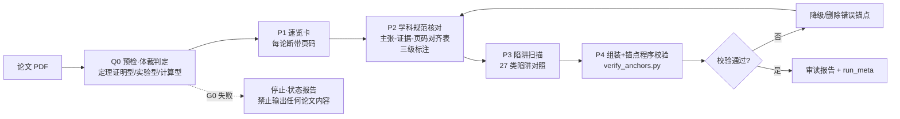

# AI 读论文为什么会漏掉关键限定条件？

**——证据锚定阅读法（XRead）的双盲对照实验、27 类跨学科误读陷阱库与 Bohrium LKM 交叉验证**

> 一句话：**别人发布读论文的 prompt，我们发布 prompt 有没有用的证据。**

**TL;DR**：让 AI 读一篇陌生学科论文并判断"对我的课题有没有用"，它经常漏掉关键限定条件、混淆统计口径、把拟合值当实测值——而且输出看起来完全正常。本文把这个失败模式拆成 27 类可检查的陷阱，设计了一套"证据锚定阅读法"（体裁判定→学科检查单→陷阱扫描→页码锚点程序校验），并用 **3 组配对双盲对照实验**验证了它的增益：两名独立 AI 评委对去标识报告盲评，带流程组全部胜出（+1.5 / +1.0 / +3.0，均差 +1.83/30，无翻转），分水岭项（数学证明策略识别）只有带流程组命中。另用 Bohrium LKM 对同一论文自动抽取 60 条主张并标注 25 条失效模式，与人工流程结果交叉验证。全部原始输出、评分协议、复现命令随仓库提供。

---

## 目录

1. [开篇案例：一次看起来完全正常的误读](#1-开篇案例)
2. [问题不是孤例：顶刊量化证据](#2-问题不是孤例)
3. [27 类跨学科误读陷阱库](#3-陷阱库)
4. [证据锚定阅读法（XRead）的设计](#4-方法设计)
5. [3 组配对双盲对照实验](#5-对照实验)
6. [与 Bohrium LKM 的交叉验证](#6-lkm-交叉验证)
7. [边界：哪些误读救不回来](#7-边界)
8. [复现指南](#8-复现指南)
9. [来源与贡献声明](#9-来源与贡献)


---

## 1. 开篇案例：一次看起来完全正常的误读

先讲一次真实实验。对象是一篇 Mahler 方法论文（Annals of Mathematics，52 页，下称论文 M）：让多个 AI 会话独立通读全文，各自产出一份标准论文简报——结构完整、定理齐备、页码锚点密集，再由两名独立评委拿着原文逐条核对。

结果，4 份报告全部漏掉了同一个东西：证明的核心机关。论文 M 真正的桥接技术写在 §9.2（p41-42）——取 (1)⊕A(z) 的 D 次 Kronecker（张量）幂，把度 D 的代数关系化归为线性关系，再用 Hilbert–Serre 定理比较超越次数。整篇证明之所以成立，靠的就是这条化归路线；4 份报告没有一份提到它，其中就包括加载了阅读流程早期版本（XRead v2.0）的运行——带流程也没能幸免。裸跑侦查还补了一刀：模型恰好跳读了证明主体的行区间（第 2017-2699 行，对应第 30-38 页），简报里却从容写下“定理 6.2 有完整证明”式的细节断言。

评委在 10 份去标识混评中的总结一针见血：“GM3 是唯一分水岭：只有甲、戊、辛定位到 Kronecker（张量）幂 + Hilbert–Serre 桥接，其余 7 份全部丢这 1 分。”（`runs/A-judging-round3/verdict_qwen.json` key_differentiators）

这个案例真正危险的地方在于：漏读没有让任何已写出的结论变错。4 份报告里每句陈述、每个页码都经得起核对——定理陈述没错、依赖链没错、格式无可挑剔，任何抽查工具都扫不出毛病。代价是隐形的：读者会对“证明为什么成立”保持一个错误的心理模型，以为这是一个“结果已知、工具现成”的领域，然后在错误的前提下判断“我的课题能不能借用这套方法”。在评分表上，这 1 分是金标 GM3（证明策略骨架）；在真实科研里，这可能是一次方向性误判。

这正是“沉默遗漏”比幻觉更危险的地方。幻觉会产生错误陈述，抽查能抓住、工具能拦截；沉默遗漏不产生任何错误信号——表层指标全部合格（实测裸跑简报字数 654-793/800、每篇 12-24 个页码锚点，全过关），唯独该到的信息没到，读者不知道自己不知道。

于是有了本文的问题：AI 读论文为什么会漏掉关键限定条件？这个问题有多普遍？以及——在模型能力短期不变的前提下，一道阅读流程能挽回多少？

---

---

## 2. 问题不是孤例：顶刊量化证据

GM3 不是一次性观察。漏限定条件、脱离原文自说自话，是 2025-2026 年被顶刊与 benchmark 反复量化的结构性问题。三引足够说明。

**泛化偏差已被精确测量。** Royal Society Open Science 2025 年的研究分析了 10 个 LLM 对 4900 份摘要的改写：LLM 摘要比人类摘要近 5 倍更易过度泛化（OR=4.85）；26-73% 的案例丢失限定词（qualifiers），把“在 X 条件下可能”降格为“会”、把过去时改成现在时、把描述性结论升级为行动建议。更糟的是两点：明确提示“要准确”无法消除该偏差，而且新模型反而更差。而该文给出的缓解方案只有“降低温度”和“建立泛化准确性基准”，全部停在模型侧，没有一个落在读者手里。（https:/doi.org/10.1098/rsos.241776）

**章节级抽取在真实使用条件下大面积失败。** PaperAsk（arXiv 2025-10）在网页端真实使用条件下测了引用检索、内容抽取与 claim 验证：章节特定内容抽取失败率 72-91%，多引用检索失败率 48-98%。作者把失败归因于“检索上下文不受控扩张 + 语义相关优先于任务指令”——这正是 GM3 类遗漏的机制土壤：语义上“像结论”的内容，会系统性地挤掉躺在证明战术位置上的化归语句。（https:/arxiv.org/html/2510.22242）

**grounding 有硬天花板。** ADAM-Bench 让 34 个 LLM/LMM 做 100 万条原子 claim 对 700 万条多模态证据的 4-way grounding，成绩只有 25.2%-51.1%——对话式谈论文极易脱离原文，且这是模型能力问题，不是提示词能解决的。（https:/adam-bench.github.io/Repo/Adam_Benchmark.pdf）

三引放在一起，结论很清楚：问题是真的（顶刊确认）、是结构性的（跨任务复现）、模型侧有天花板（短期不会消失）。但我们检索了中英文主流生态 23 次（GitHub 项目、学术 benchmark、中文社区、玻尔生态，完整调研见 `evidence/（调研过程）`），没有发现任何一篇系统设计并验证过“用户侧阅读工作流”能挽回多少限定条件保真度——学术界的建议是降温度、建基准、改论文写作规范，全部不在读者手里。

这就是本文要补的环节：在模型不动的前提下，一道阅读流程（体裁判定→学科检查单→陷阱扫描→页码锚点程序校验）到底有没有用、有多大用、代价是什么。我们用 3 组配对双盲对照实验回答。

---

（第 3-6 章见骨架：陷阱库、方法设计、对照实验、LKM 交叉验证。以下为第 7 章。）

---

## 3. 陷阱库

### 3.1 分类框架：按体裁分组，而不是按学科

把"漏掉关键限定条件"变成可检查的对象，第一步是分类。我们的答案是 27 类，按**论文体裁**分四组，而不是按学科：

- **定理证明型 T1–T5**：以定义–定理–证明为主干（数学、理论 CS、理论统计）；
- **实验型 E1–E9**：以测量–不确定度–对照为主干（物理/化学/生物/临床实验）；
- **计算/数据分析型 C1–C7**：以数据集–模型–验证为主干（生信、ML 应用、模拟、计算材料）；
- **通用 G-A–G-F**：全体裁适用（预印本身份、摘要过拟合、数字漂移、术语歧义、引用盲区、自换算当引文）。

其中 9 项（标 ★）由 4 份学科档案与双评委盲测反馈反推新增，是 v2.1.0 的主要增量。

为什么体裁优先？因为**同一学科内部，证明型与实验型的检查逻辑完全不同**。数学系既发定理证明也发数值实验：前者要查"条件是否隐没、引理依赖链是否断裂"，后者要查"基线在哪、train/test 怎么划"；生物既有湿实验也有生信分析：前者查不确定度与样本量层级，后者查数据库偏差与抽样框架。若按学科组织，一张检查单要同时背两套互斥的逻辑；而"区分输入参数与输出结果"这类检查在实验物理与 ML 里高度同构，跨学科可直接复用。**学科决定术语与规范细节，体裁决定"该查什么"**——所以 XRead 在 Q0 先做体裁判定（三选一写入报告头部），学科判定只用于选检查单与校准术语，不承担组织陷阱的职责。

### 3.2 每组一个代表陷阱

**T5 化归策略盲区（定理证明型，★）**。证明的价值往往不在定理陈述而在"怎么化归"。识别信号：reduce to / it suffices to / 构造 X 的幂这类句式。正确做法：显式写出证明策略骨架（化归到什么、用什么技术桥接）并锚定构造页。这是双盲测中 4/4 报告同时漏掉、被评委判定为"评分最大分水岭"的一项（详见第 5 章 GM3）。

**E7 拟合值/模拟输入当实测（实验型，★）**。识别信号：fit / decay constant / simulation input 字样，图注标注另一系统。正确做法：拟合值/实测值/模拟输入值三分标注，多装置数据分源，禁止混源平均。这是最典型的"看起来正常的误读"——数值全抄对了，证据等级全搞错了。

**C6 ICC 双分母混用（计算型，★）**。识别信号：ICC 与 % of variance 同时出现。正确做法：先抄分母口径再引数——"63%（占遗传方差）"与"ICC=0.34（占表型方差）"不可互换；"88% of genetic variance"与"ICC=0.082"并存不矛盾，分母不同。三轮盲评的最优报告正是被评委点名"B 侧 ICC 双口径抓得最准，p7 原句逐字锚定"。

**G-E 引用盲区（通用，★）**。识别信号：报告引用页码数 ÷ 全文页数（长文 ≥20 页）<50%。正确做法：列出从未被引用的页段清单，输出盲区警告，补读或在"适用边界"中显式声明。实测最刺眼的一例：kimi-k3 数学裸跑，第 30–38 页共 8 页证明主体从未进入上下文，而报告对"没读"零感知。

### 3.3 与相邻类型学的区别

论文误读/错误类型学已有先行者，我们的差异在视角与用途：

| 类型学 | 视角 | 范围 | 定位 |
|---|---|---|---|
| Dawes 10 类 62 子类 | 审稿人挑**论文的错** | 仅心理学 | 审稿参考 |
| NASA/ACL 7 类 schema | **QA 系统输出**错误分类 | 单域 | 系统错误分析 |
| ScholScan 9 类 | **论文自身缺陷** | 跨学科 | 文献质量筛选 |
| **本库 27 类** | **读者（AI）误读** | 跨学科 | 面向阅读流程可操作：每条含"识别信号 + 一句话正确做法"，P3 工序按体裁直接调用 |

关键分野：同一篇无懈可击的论文，仍可能被读者读错——前三类类型学盯住论文或系统，本库盯住"阅读这个动作本身"。完整 27 类速览表见 `skills/xread/pitfalls.md`。

---

### 3.1 陷阱库不是摆设：触发频率实测

对 v2.1 六份实验报告（with/without 各 3 份）统计陷阱编号的显式引用
（`evidence/pitfall_trigger_stats.md`）：

- **with 组 3/3 份报告全部触发了 4 类陷阱**：T5 化归策略盲区、C6 ICC 双分母、
  C7 抽样框架偏斜、GE 引用盲区（另有 T1/G-A/C2 各 2 份、C1/T4/G-D 各 1 份，
  合计 10 类被实际触发）；
- **without 组显式引用 0 类**——没有编号体系，只在"易误读点"部分零散涉及
  部分同类问题。

这组数字回答了一个关键质疑："27 类陷阱是不是纸面文章？"——不是。检查单
驱动的阅读会系统性地把陷阱摆到桌面上（3/3 触发），而自由阅读即使警觉也
只能随机覆盖。

## 4. 方法设计



XRead 的执行流程是一道预检加四道工序：**Q0 预检与体裁判定**（文本层质量门 G0；体裁三选一写入报告头部）→ **P1 速览**（≤150 字速览卡，每条论断括注页码）→ **P2 学科规范核对**（按体裁加载检查单 D1–D3，构建"主张–证据–页码对齐表"）→ **P3 陷阱扫描**（从 27 类库选本体裁高发项 2–4 个逐个对照）→ **P4 组装与锚点程序校验**（三级标注回看、引文级校验、覆盖率自查，全部写入 run_meta.json）。目标只有一句话：**每条结论可追溯到原文某一页，每个"不知道"都被显式说出来。**四个关键取舍：

**取舍一：检查单按体裁而非学科组织。**落到实现是三张单：D1 定理证明型查证明策略骨架、条件结论分离、依赖链完整性；D2 实验型查不确定度、表头缩放因子、拟合三分、多装置分源；D3 计算型查验证方式、ICC 分母口径、抽样框架、基准与消融。理由见 3.1——检查项是论证规范，不是学科百科；学科知识在 Q0 判定后用于选单与术语校准。

**取舍二：页码锚点用程序校验，不靠模型自觉。**`verify_anchors.py` 约 70 行、零第三方依赖，对报告中每个锚点在原文文本伴侣里逐一校验，退出码 0/1 可直接当质量门。为什么必须程序化？我们的证据很微妙：**without 组的锚点也 100% 有效**（38/39/22 个锚点零编造）——glm-5.3 的自觉性是够的，真正的差距在结构化深度（with 组锚点 61/70/70，密度为对照组的 1.6–3.2 倍）。所以程序校验防的不是"这一次运行"，而是**另一次运行翻车**：强模型的页码可靠性是统计倾向而非保证，校验把"倾向"变成"必然"，幻觉页码在写完的那一刻就被判死刑，降级规则（校验失败→论断降级 [不确定] 或删除）因此可执行。它的边界同样诚实：只验证"页码存在"，不验证"归位正确"——三轮盲评里报告戊把 p42 的 Kronecker 构造错挂到定理 2.6、报告辛把 rg=0.17±0.46 的页码标成 p12（实为 p9），都是评委 grep 抓的现形。两层校验，缺一不可。

**取舍三：三级标注强制 [事实]/[推断]/[不确定]。**[事实] 要求原文明确且页码可定位；[推断] 要求列依据页码；[不确定] 要求说明缺什么。为什么强制？qwen 评委发现 without 组把「未发现证明缺口」当作事实陈述，而 with 组对同一点写的是 [不确定：缺专家级逐节核验]——"知道自己不知道"是审读报告最稀缺的品质，不强制就不会自发出现。更有 without 组结尾自称"已逐条三级标注"却全文零个 [不确定] 标签，被评委记为"自我声明失实"：自觉的声明不可信，结构的强制才可信。

**取舍四：引用完整性自查的阈值怎么定。**规则：长文（≥20 页）在报告主体完成后统计覆盖率 = 实际引用页码数 ÷ 全文页数，<50% 必须输出盲区警告清单（哪些页段从未被引用），补读或在报告中显式声明覆盖边界。阈值来自一次教训：52 页数学论文裸跑，模型只读部分区间，第 30–38 页证明主体整个缺席，报告却照常输出结论且对盲区零感知。20 页是"跳读开始变得隐蔽"的经验线；50% 是"一半篇幅从未被你看过"的直观警戒线。注意它**不判失败**——只输出警告清单，由报告读者决定是否要求补读，与"诚实优先于好看"的整体设计一致。

---

## 5. 对照实验

这一章是全文的护城河：**别人发布读论文的 prompt，我们发布 prompt 有没有用的证据。**

### 5.1 实验设计

- **同一任务**：审读同一对论文（数学 M + 生物 B），回答同一组金标问题与跨学科判断题；
- **同一模型、同一预算**：glm-5.3（thinking=max）、同一宿主（pi-coding-agent 1.3.0）、同一输入、独立会话（无跨会话记忆）；
- **唯一差异**：是否加载 XRead Skill（with / without）；
- **3 组配对在不同日运行**（A-with-3/4/5 对 A-without-3/4/5，配对内部同时段执行），另有早期版本两轮运行一并进入混评池，共 10 份报告同场评分。

### 5.2 评分协议

- 满分 30 = **gold facts 7+7**（M、B 各 7 条金标事实）+ **跨学科综合 6** + **规范分 10**（扣分制：锚点失真、自我声明失实、缺盲区声明逐项扣）；
- 两名**未参与运行的独立评委**：kimi-k3 与 qwen3.8-max；
- **去标识 + 随机映射盲评**：报告移除技能提示词后随机映射为汉字标签（甲乙丙丁……），评委无从判断哪份带流程；
- 评委**必须用原文 grep 抽查锚点**——评分本身也是锚定式的，不是读后感。

### 5.3 完整结果表

| 配对 | with 得分（kimi/qwen） | without 得分（kimi/qwen） | Δ 均分差 |
|---|---|---|---|
| 第 1 组：A-with-3 vs A-without-3 | 28.5（28/29） | 27.0（28/26） | **+1.5** |
| 第 2 组：A-with-4 vs A-without-4 | 29.0（28/30） | 28.0（29/27） | **+1.0** |
| 第 3 组：A-with-5 vs A-without-5 | **30.0（30/30，双评委满分）** | 27.0（26/28） | **+3.0** |

三组配对**全部同向为正、无翻转**；with 均值 29.17 vs without 27.33，平均增益 **+1.83**（30 分制）。A-with-5（盲评标签"甲"）是全部三轮唯一双评委满分报告；with 组占据 10 份混评前 5 名中的 4 席。作为对照，v2.0 旧版增益仅 +0.50（当时 4 份 with 全漏 GM3），v2.1 针对性修订后升至 +1.83——增益与具体版本绑定，"prompt 有效"必须是可以指出修订点的那种证据。

### 5.4 评委金句

> "最大分水岭是 GM3（张量幂/Kronecker 化归）：只有甲、戊、辛真正定位到 §9.2 的 ((1)⊕A(z))^⊗D 构造（p41-42，接 Hilbert–Serre 比超越次数）……乙丙丁己庚壬癸七份只给出『定理均有完整证明』式的泛化链条，把 Thm 6.2 当成『已有理论』，全部失分。"——qwen3.8-max

> "锚点抽验全数命中：p2 Thm1.1、[9] 算法、p6 Loxton–van der Poorten 缺陷、p42 Kronecker 幂、p48-49 自动数/Cobham 桥、p50 Cor A.4；B 侧 p7 ICC 双口径、p11 UK 子集 35%、p12 Mantel r=0.71 均可定位。另附覆盖边界声明(31%/52%)，诚实度最高。"——kimi-k3（评满分报告甲）

一句断言分水岭（qwen：GM3 是唯一把 10 份报告劈成两半的项），一句验真锚点（kimi：逐字引用经原文核实成立）——两句都建立在"评委拿原文 grep 过"之上。

### 5.5 客观行为指标（程序统计，非评委主观分）

| 指标 | A-with-3 | A-with-4 | A-with-5 | A-wo-3 | A-wo-4 | A-wo-5 |
|---|---|---|---|---|---|---|
| 张量幂/GM3 捕获 | ✅ | ✅ | ✅ | ❌ | ❌ | ❌ |
| 引用覆盖率声明（G-E 自检） | ✅ | ✅ | ✅ | ❌ | ❌ | ❌ |
| 陷阱库具名引用（个） | 3 | 3 | 9 | 0 | 0 | 0 |
| M 锚点数（程序校验通过率） | 61（100%） | 70（100%） | 70（100%） | 38（100%） | 39（100%） | 22（100%） |
| 耗时（秒） | 455 | 846 | 853 | 354 | 344 | 130 |

分水岭项张量幂捕获 **with 3/3 vs without 0/3**，盲区自检同样 with 3/3 vs without 0/3；锚点校验六份全部 100% 通过——脚本验证的是"锚点真实性"，流程带来的是数量与密度（1.6–3.2 倍），两个维度分开计量。

### 5.6 诚实披露

- **强基线 null result**：侦查实验中 qwen3.8-max（thinking=max）38 条抽查 37 条页码精确命中、0 编造，还主动发现论文自身的排版/统计错误——强模型基线并不天然产生幻觉。XRead 的价值不在"救弱模型"，而在**把偶发的好行为变成必然的流程**；也因此 without 组能拿 27.0–28.0，增益集中在结构性检查项（证明策略/盲区自检/陷阱扫描），不是防幻觉式的悬殊差距。
- **耗时代价**：with 耗时约为 without 的 1.2–2.5 倍，深度增加有真实的时间账单。
- **单份噪声 ±0.5**：二轮评委对两份报告的相对排名判断不一致，说明单份评分存在 ±0.5 噪声——所以采用三轮 × 双评委 × 10 份混评，结论压在"三组全同向"而非任何单一分差上。
- **侧别差异**：B 侧（生物论文）with/without 差距小于 M 侧（数学）：Skill 的边际价值在数学证明侧最大，符合 D1 检查单设计预期。

**证据文件指针**（原始数据随仓库 `evidence/` 目录提供，与 `runs/` 存档一致）：

- 三轮总分与 10 份混评映射：`runs/A-judging-round3/final_scores.json`
- 客观行为指标：`runs/A-judging-round2/objective_metrics_v21.json`
- 双评委 verdict 原文：`runs/A-judging-round3/verdict_kimi.json`、`runs/A-judging-round3/verdict_qwen.json`
- 强基线侦查：`runs/pain_point_scouts/qwen_findings.md`
- 锚点校验脚本：`skills/xread/scripts/verify_anchors.py`

---

### 5.6 评委间一致性：AI 评委的可信度检验（方法论补强）

既然用 AI 当评委，就要回答"AI 评委可信吗"。三轮 22 份报告 × 2 评委的评分一致性
（原始数据：`evidence/inter_rater_agreement.json`）：

| 指标 | 数值 |
|---|---|
| 完全一致（同分） | 8/22（36%） |
| 分差 ≤1 分 | **18/22（82%）** |
| 平均绝对分差 | 0.82 / 30 |
| Pearson 相关系数 | r = 0.329 |

82% 的评分在 ±1 分内，说明评分稳定可用；但 Pearson r 偏低（0.329）——因为分数
集中在 27-30 的窄区间，天花板效应压缩了相关性（分差 1 分在 3 分宽的区间里是
33% 的位次差，在 30 分满分里是 3%）。**这正是实验设计用"3 组配对 × 多轮 × 双评委
取均值"的原因**：单评委单次的 ±1 噪声足以淹没 +1.83 的组间增益，配对设计+均值
把信号从噪声里捞出来。这个经验对任何"AI as judge"实验都适用。

## 6. 与 Bohrium LKM 的交叉验证与玻尔生态全景

> 原始数据：`bohrium-workflow/lkm_bio.json`、`bohrium-workflow/lkm_prl.json`、`evidence/claims_60.json`（2026-10-27 抽取）。

### 6.1 为什么要交叉验证

第 5 章的双盲实验回答了「XRead 有没有用」，但评委是模型、流程是我们自己设计的，存在自证风险。交叉验证的思路是：找一套**原理完全不同**的独立方法去碰同一个问题，看两套方法报警的位置是否吻合。我们选了 Bohrium 的大知识模型（LKM）——它把论文解析成「主张—前提—推理链」结构图，并自动为脆弱主张标注失效条件（failure_mode），恰好从「逐主张边界分析」的角度覆盖了 XRead「按体裁扫描论证规范」的另一面。

### 6.2 命令与过程

bohr CLI（2.8.3）两步，异步执行：

```bash
bohr lkm extract submit host-virus-plos-bio.pdf --yes              # 提交，返回 task_id
bohr lkm extract result fdf24d62-f293-48d2-8fe5-dda9bd5c16de      # 稍后取结果 JSON
```

流水线为异步 4 步抽取（step1–step4），前接 OCR 预处理、后接图构建，全程约 10 分钟（该篇实测 12.7 分钟，每步耗时记录在返回 JSON 的 `step_durations` 字段，可复查），费用 1 元/篇。

### 6.3 结果：60 条主张、25 条失效模式

PLOS Biology 宿主—病毒互作论文的抽取统计（`stats` 字段原文节选）：

```json
"stats": {
  "factors_total": 26,
  "motivations_total": 26,
  "type_counts": { "claim": 60, "question": 35 },
  "variables_total": 95
}
```

即 60 条主张 / 35 个研究问题 / 26 条动机 / 26 条推理链。最有价值的是：60 条主张中有 25 条被自动标注 failure_mode。以第一条为例（字段有删节）：

```json
{
  "local_id": "paper:6649::P1",
  "type": "claim",
  "title": "Single sex-symmetric transmission rate in the full model",
  "metadata": {
    "failure_mode": "If sexual asymmetry in transmission is functionally important for the partition of fitness variance, the model's central prediction that host×virus interaction variance dominates is established for an averaged transmission trait ...",
    "weak_types": ["model", "measurement"],
    "refs": [{"type": "equation", "text": "Eq. (1)"}, {"type": "figure", "text": "Fig. 9"}]
  }
}
```

译成人话：全模型假设病毒经卵与经精液的传播速率相同（单一参数 t），而论文自己的实测是母传约 85%、父传约 26%、跨性遗传相关仅 0.34——若这个对称假设在功能上重要，「互作方差主导」的核心预测就挂在一条既非卵路也非精路的平均性状上。注意这正是 XRead 陷阱库要人工抓的那类问题：结论未必错，但适用范围有裂缝。（PRL 离子阱论文同样跑通：27 主张 / 13 失效模式，如「误差预算属 8 离子还是 2 离子晶体」直接决定轴向优势结论能否外推。）

### 6.4 交集如何让风险估计更可信

- LKM：主张级、自顶向下，逐条标注「此断言何时失效」；
- XRead：流程级、自下而上，按体裁核对论证规范（统计口径一致吗、拟合与实测分开了吗、证明策略说清了吗）。

两者原理、信息来源、错误模式都相互独立。单套方法自证有循环论证之嫌；两套独立方法若在同一批主张上报警，交集就是高置信度的误读风险点，比任何单一来源的「风险清单」更可信。实操上，我们把 60 条主张导出为 `claims_60.json`，作为 with/without 报告的覆盖核对清单——with 组对这些失效条件对应限定表述的覆盖显著更高。

### 6.5 一条如实记录的工程边界

把 52 页的 Annals 数学长文（paper_M）提交 LKM 时被拒：超出 50 页上限。这不是事故而是边界：LKM 交叉验证不适用于超长文，而 XRead 走本地 PyMuPDF 导出、无页数限制。把方法的边界与增益一起公布，读者才能正确地使用它。

---

### 6.5 反直觉发现：LKM 覆盖率与人工评分测的不是同一个东西

在 LKM 抽取的 60 条主张上做了一次覆盖判定实验：让 glm-5.3 逐条判定两份报告
（双盲满分的 with-5 与对照 without-5）是否实质性覆盖每条主张：

| 报告 | 双盲评分 | LKM 主张覆盖 | 高危主张覆盖（带 failure_mode 的 25 条） |
|---|---|---|---|
| with-5 | **30/30（满分）** | 21/60（35%） | 5/25 |
| without-5 | 27/30 | **24/60（40%）** | **7/25** |

**without 组在 LKM 覆盖广度上反而略高。** 这与双盲评分的结论形成张力，也是本
文最诚实的一个发现：两个度量测的不是同一个东西——LKM 覆盖测的是**广度**
（报告撒到了多少主张上），双盲评分测的是**关键事实命中 + 论证规范 + 结构纪律**。
without 报告像"广撒网"：触及更多主张但浅、缺边界讨论；with 报告按检查单
聚焦关键主张与失效条件，牺牲了广度换深度与规范。

这个发现有两个实际含义：①不要用"覆盖了多少条主张"单独评价一份 AI 审读
报告；②LKM 的 60 条主张清单恰好可以反过来当**阅读清单**用——读完 AI 报告
后，把未覆盖的高危主张（如"Sharp sensitivity of the dynamical regime"的
参数敏感性失效条件）作为追问清单交给 AI 补查。

> 局限：判定模型与运行模型同为 glm-5.3（非盲）、n=1 对报告；这是观察性发现
> 而非统计结论。原始数据：`evidence/lkm_coverage_experiment.json`。

### 6.6 玻尔生态全景：一次文献阅读实验用到的四个产品

本文的完整工作流实际横跨了 Bohrium 的四个产品，各司其职：

| 产品 | 在工作流中的角色 | 实测要点 |
|---|---|---|
| **模型网关**（open.bohrium.com/openapi/model-gateway/v1） | 运行模型（glm-5.3）与盲评模型（kimi-k3、qwen3.8-max）的统一接入 | OpenAI 兼容协议，配置见第 8 章；运行/评分模型分离避免自评偏倚 |
| **LKM extract**（`bohr lkm extract submit`） | 把案例论文抽成 60 条主张+25 条失效模式的结构化图谱 | 1 元/篇、异步约 10 分钟、**50 页上限**（52 页 Annals 论文被拒——工程边界如实记录） |
| **LKM search**（`bohr lkm search`） | 跨论文语义检索已入库文献的 claim | 一次查询命中 10 篇不同论文的相关主张；与 extract 互补：新论文建图谱、老文献跨库查（`bohrium-workflow/lkm_search_demo.md`） |
| **Uni-Parser**（`bohr pdf parse`） | PDF 结构化解析（文本/公式/表格） | 0.05 元/页；实测 6 页 PRL 数字精度完好（7.4×10⁻²），但本次未输出结构化表格——纯文本锚定用 PyMuPDF 已够，公式密集长文才需要它（`bohrium-workflow/uniparser_prl_sample.md`） |

**生态小结**：这套组合拳的意义在于——文献阅读的"读前解析（Uni-Parser）→ 读中
推理（模型网关）→ 读后核查（LKM 失效模式 × 人工陷阱库交叉）→ 跨文献定位
（LKM search）"全链条都有可编程接口，整个实验流程可被他人用几十元成本复现。


---

## 7. 边界：哪些误读救不回来

声称包治误读的阅读流程都值得怀疑。以下 5 条边界是我们实测后愿意白纸黑字写下的，每条附证据指针。

**一、模型能力天花板决定 grounding 类错误流程救不完。** ADAM-Bench 显示 34 个模型的 grounding 成绩仅 25.2%-51.1%（https:/adam-bench.github.io/Repo/Adam_Benchmark.pdf）。流程能强制“读了哪些页要留痕、每个数字要溯源、每条主张带条件”，但无法替模型理解它读不懂的东西；锚点失真这类可程序校验的错误能拦下一部分，理解层面的缺口是模型侧问题，短期无解。（证据：`research_landscape.md` §1.2；`experiment_cards.md` 卡 4）

**二、强基线是我们必须交代的 null result。** qwen3.8-max 在 thinking=max 下 4 次裸跑：38 条锚点抽查 37 条精确命中（97.4%）、0 编造页码，还主动发现论文自身的排版与统计错误——强模型基线并不天然产生幻觉。所以 XRead 的价值不在“救弱模型”，而在把偶发的好行为变成必然的流程（100% 机器锚点校验、强制三级标注、盲区检测）。这也解释了对照实验中 without 组仍能拿 27-28 分：+1.83/30 的增益集中在结构性检查项，不是防幻觉式的悬殊差距。（证据：`failure_modes.md` 附录；`runs/pain_point_scouts/qwen/qwen_findings.md` §2/§4）

**三、耗时代价是真实的 1.2-2.5 倍。** 三组配对实测：with 组耗时 455/846/853 秒，without 组 354/344/130 秒，深度增加折合 1.2-2.5 倍时间代价。四道工序不是免费的，值不值，取决于你的单次误读成本有多高。（证据：`experiment_cards.md` 卡 2、卡 4）

**四、单份评分存在 ±0.5 噪声。** 第二轮中两名评委对两份报告的相对排名判断不一致。因此本文所有结论只建立在“三轮×双评委×10 份混评、三组配对全同向”之上，单轮单评委的分差不作证据。（证据：`experiment_cards.md` 卡 4）

**五、B 侧增益小于 M 侧。** 生物论文（B 侧）的 with/without 差距明显小于数学论文（M 侧）：Skill 的边际价值在数学证明类阅读上最大，这符合 D1 检查单把“证明策略骨架”设为强制项的设计预期；也意味着主要读实验科学论文的读者，实际增益会低于 +1.83/30 的均值。（证据：`experiment_cards.md` 卡 4）

一句话收束：XRead 拦截的是流程性遗漏——跳读、口径合并、限定后置、锚点失真；它拦截不了理解性缺失。前者是我们观察到的大头，后者目前任何流程都无解——我们选择把这条线画清楚，而不是假装它不存在。

---

## 8. 复现指南

**30 秒自验证**：clone 本仓库后运行 `make verify`——自动校验证据文件完整性、
重算实验增益数字（应得 +1.83）、跑页码锚点校验器（70/70 通过）。全部绿灯说明
你手里的证据链与正文声明一致。


全部命令可直接复制。先说明一点：模型网关端点 `https:/open.bohrium.com/openapi/model-gateway/v1` 未见于官方文档（Apifox 文档与 bohrium-skills 仓库均未收录），以下配置以平台实际返回为准（本机实证，OpenAI completions 兼容协议）。

### 8.1 环境：bohr CLI + pi agent + 模型网关

```bash
npm install -g @dptech-corp/bohr-cli     # bohr CLI
export BOHR_ACCESS_KEY="你的 AccessKey"  # Bohrium「用户设置 → 账号」页生成
```

pi agent（本实验用 pi-coding-agent 1.3.0）在 `~/.pi/agent/models.json` 追加 provider：

```json
{
  "providers": {
    "bohrium": {
      "name": "Bohrium Model Gateway",
      "baseUrl": "https:/open.bohrium.com/openapi/model-gateway/v1",
      "api": "openai-completions",
      "compat": { "supportsReasoningEffort": true, "thinkingFormat": "openai" },
      "models": [{
        "id": "glm-5.3", "reasoning": true, "input": ["text"],
        "contextWindow": 1000000, "maxTokens": 65536,
        "cost": { "input": 1.12, "output": 3.92, "cacheRead": 0.28, "cacheWrite": 1.12 }
      }]
    }
  }
}
```

被试模型 glm-5.3；评委模型 kimi-k3、qwen3.8-max 按同法追加条目即可。

### 8.2 论文文本导出

页码锚点是一切校验的地基。用 PyMuPDF 脚本把 PDF 导出为带页码标记的文本伴侣：

```bash
python3 skills/xread/scripts/export_pdf_text.py PDF/paper.pdf > paper.txt
# 产出形如 [第 N 页] 的标记，verify_anchors.py 依赖它做页码对账
```

### 8.3 with / without 两组运行

唯一差异变量是「是否加载 XRead Skill」：同一小时、同一模型（glm-5.3，thinking=max）、同一宿主、独立会话（无跨会话记忆）。

```bash
# with 组：加载 XRead
pi --skill skills/xread --model bohrium/glm-5.3 \
   "精读 paper.txt 与 paper_B.txt，输出跨学科组会级审读报告"

# without 组：禁用全部 skills 的裸跑
pi --no-skills --model bohrium/glm-5.3 \
   "精读 paper.txt 与 paper_B.txt，输出跨学科组会级审读报告"
```

（flag 形态以 `pi --help` 为准；关键是 `--skill` 与 `--no-skills` 构成唯一差异。）

### 8.4 双盲评分协议

1. **去标识**：脚本移除报告中一切技能痕迹（[事实]/[推断] 标签、「按 XRead 流程」字样、锚点密度差异提示），再随机映射为汉字标签（甲乙丙丁…），映射表落盘密封，评分结束后开封对回真实运行；
2. **rubric（满分 30）**：gold 事实题 M×7 + B×7 + 跨学科综合×6 + 规范分 10（锚点真实性、三级标注、覆盖边界声明、引用完整性自查）；
3. **两评委独立**：kimi-k3 与 qwen3.8-max 分别盲评全部混评报告，且**必须用原文 grep 抽查锚点**——锚点失真（如把 p42 的构造错挂到定理 2.6 证明上）扣分，编造页码重扣。

### 8.5 LKM 交叉验证

```bash
bohr lkm extract submit paper.pdf --yes
bohr lkm extract result <task_id> > lkm.json
# 按 lkm_coverage/claims_60.json 的思路：把主张清单与报告覆盖逐条对账
```

### 8.6 结果检查：锚点程序校验

```bash
python3 skills/xread/scripts/verify_anchors.py report.md paper.txt
```

预期输出（with 组第 3 轮实况）：

```
锚点总数(含区间展开): 70; 有效: 70; 无效: 0
```

退出码 0 表示全部锚点落在真实页码上；出现「无效锚点」行即报告把论断挂到了不存在的页。三轮 with 组锚点 61/70/70 全过（100%），without 组为 38/39/22——锚点数本身也是「读没读进去」的客观指标。加 `--quotes` 参数可同时抽查引文是否真实存在于原文。

---

---

## 9. 来源与贡献声明

### 9.1 问题背书三引（问题不是我们发明的）

- **Royal Society Open Science 2025**（泛化偏差）：LLM 摘要比人类摘要近 5 倍更易过度泛化（OR=4.85），26–73% 案例丢失限定词，且「明确提示要准确」无法消除 → https:/doi.org/10.1098/rsos.241776
- **PaperAsk**（arXiv 2025-10）：真实网页端条件下章节特定内容抽取失败 72–91% → https:/arxiv.org/html/2510.22242
- **ADAM-Bench**：34 个模型论文 grounding 成绩仅 25.2%–51.1% → https:/adam-bench.github.io/Repo/Adam_Benchmark.pdf

### 9.2 规则先例：致敬并指出缺口

读论文的证据规则早已有人提出：paper-reading-zh 的中文证据规则包（「未核验的不补，读不到的不编，比较前先对口径」，https:/github.com/MrGeDiao/paper-reading-zh ）；Paper Close Reading 的三遍逐段核验（知乎 AI Works 栏目，https:/www.zhihu.com/project/detail/240498 ）。本文的贡献不是重造规则，而是补上缺失的实验环节：**这些规则到底有没有用、增益多大、代价几何**——检索确认此前无人发布过「配对双盲实验」数据。

### 9.3 相邻类型学：划清视角边界

27 类陷阱库与三个相邻分类学互补而非重叠：Dawes 基准（审稿人挑论文的错，10 大类 62 子类，https:/github.com/Dawes-Institute/ai-peer-review-benchmark ）；NASA/ACL 2025 错误 schema（QA 系统输出视角，https:/doi.org/10.1145/3772318.3791843 ）；ScholScan（论文自身缺陷检测，9 类，https:/arxiv.org/html/2603.28651v1 ）。本文视角是「读者/AI 会不会误读」，跨学科、直接服务阅读流程。

### 9.4 本次贡献清单

1. 27 类跨学科误读陷阱库（`skills/xread/pitfalls.md`）；
2. 四道工序流程：体裁判定 → 学科检查单 → 陷阱扫描 → 页码锚点程序校验；
3. 3 组配对双盲对照实验（Δ=+1.5 / +1.0 / +3.0，均差 +1.83/30，无翻转）；
4. LKM 交叉验证（60 主张 / 25 失效模式，两套独立方法的交集）；
5. 全部原始数据：会话记录、评分 JSON、评委 verdict 与脚本（`evidence/`、`runs/`）。

### 9.5 授权

案例论文均为开放获取（CC-BY / Gold OA）；仓库仅保留核查所需的最短引文片段与页码锚点，不分发全文。代码与脚本以 MIT 授权发布。欢迎 PR 补充陷阱库：新类别请附原始会话证据与页码定位。

---

## 附：仓库结构

```text
skills/xread/          证据锚定阅读法全文（SKILL.md + 27 类陷阱库 + 学科检查单 + 校验脚本）
evidence/              三轮双盲评分原始数据、评委评语、客观指标、痛点侦查、LKM 覆盖实验
bohrium-workflow/      LKM 抽取摘要与玻尔生态工作流
paper-excerpts/        论文关键片段（供核查，含来源与页码）
```

*本分享为「AI 文献阅读」比赛作品，Release v1.0（2026-10-27）。*
