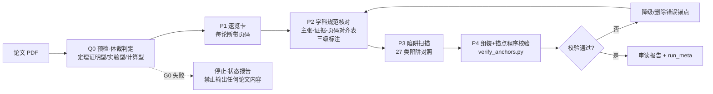

# Why AI Misses Critical Qualifiers When Reading Papers: A Double-Blind Controlled Experiment on Evidence-Anchored Reading, a 27-Type Misreading Trap Taxonomy, and Cross-Validation with Bohrium LKM

> In one sentence: **others publish prompts for reading papers; we publish evidence on whether those prompts actually work.**

**TL;DR**: Ask an AI to read a paper from an unfamiliar field and judge whether it's useful for your own research, and it will routinely drop critical qualifiers, conflate statistical denominators, and pass off fitted values as measured ones—and the output looks perfectly fine. This paper breaks that failure mode into 27 auditable trap types, designs an "evidence-anchored reading" workflow (genre classification → discipline checklist → trap scan → page-anchor programmatic verification), and validates its gains with **3 paired double-blind controlled experiments**: two independent AI judges blind-scored de-identified reports, and the workflow group won every pairing (+1.5 / +1.0 / +3.0, mean +1.83/30, no sign flips); the watershed item (identifying the mathematical proof strategy) was hit only by the workflow group. We additionally used Bohrium LKM to automatically extract 60 claims from the same paper and annotate 25 failure modes, cross-validating against the manual workflow's results. All raw outputs, scoring protocols, and reproduction commands ship with the repository.

---

## Table of Contents

1. [Opening Case: A Misreading That Looked Perfectly Normal](#1-opening-case)
2. [Not an Isolated Case: Quantitative Evidence from Top Journals](#2-not-an-isolated-case)
3. [The 27-Type Cross-Disciplinary Misreading Trap Taxonomy](#3-trap-taxonomy)
4. [Design of the Evidence-Anchored Reading Method (XRead)](#4-method-design)
5. [3 Paired Double-Blind Controlled Experiments](#5-controlled-experiments)
6. [Cross-Validation with Bohrium LKM](#6-lkm-cross-validation)
7. [Boundaries: Which Misreadings Cannot Be Recovered](#7-boundaries)
8. [Reproduction Guide](#8-reproduction-guide)
9. [Sources and Contribution Statement](#9-sources-and-contributions)


---

## 1. Opening Case: A Misreading That Looked Perfectly Normal

Start with a real experiment. The subject was a paper on the Mahler method (Annals of Mathematics, 52 pages, hereafter paper M): multiple independent AI sessions each read the full text and produced a standard paper briefing—well-structured, complete with theorems, densely annotated with page anchors—which two independent judges then checked line by line against the original.

The result: all 4 reports missed the same thing—the core mechanism of the proof. Paper M's actual bridging technique is written in §9.2 (p41-42): take the D-th Kronecker (tensor) power of (1)⊕A(z), reduce a degree-D algebraic relation to a linear one, and then use the Hilbert–Serre theorem to compare transcendence degrees. The entire proof stands on this reduction route; not one of the 4 reports mentioned it—including runs that had loaded an early version of the reading workflow (XRead v2.0). The workflow didn't save them either. A bare-run scout added insult to injury: the model happened to skip precisely the line range containing the body of the proof (lines 2017-2699, corresponding to pages 30-38), while the briefing calmly asserted things like "Theorem 6.2 has a complete proof."

A judge's summary from the 10-report de-identified pool hit the nail on the head: "GM3 is the sole watershed: only 甲, 戊, and 辛 located the Kronecker (tensor) power + Hilbert–Serre bridge; the other 7 all lost this 1 point." (`runs/A-judging-round3/verdict_qwen.json` key_differentiators)

The truly dangerous part of this case is that the omission did not make any written conclusion wrong. Every statement and every page number in the 4 reports survived checking—the theorem statements were correct, the dependency chains were correct, the formatting was impeccable, and any spot-checking tool would have found nothing wrong. The cost was invisible: the reader walks away with a wrong mental model of *why the proof works*, assumes this is a field where "the results are known and the tools are ready-made," and then judges "can my project borrow this method" from a false premise. On the score sheet, that 1 point is the gold-standard item GM3 (proof-strategy skeleton); in real research, it could be a directional misjudgment.

This is exactly why "silent omission" is more dangerous than hallucination. Hallucination produces false statements—spot checks catch them, tools intercept them. Silent omission produces no error signal at all: every surface metric passes (measured bare-run briefing length 654-793/800 words, 12-24 page anchors per report, all passing), yet the information that should have arrived never did—and the reader doesn't know what they don't know.

Hence the questions of this paper: why does AI miss critical qualifiers when reading papers? How prevalent is the problem? And—holding model capability fixed in the short run—how much can a reading workflow recover?

---

---

## 2. Not an Isolated Case: Quantitative Evidence from Top Journals

GM3 is not a one-off observation. Missing qualifiers and drifting away from the source text are structural problems that top journals and benchmarks repeatedly quantified in 2025-2026. Three citations suffice.

**Generalization bias has been precisely measured.** A Royal Society Open Science 2025 study analyzed how 10 LLMs paraphrased 4900 abstracts: LLM summaries were nearly 5x more prone to overgeneralization than human ones (OR=4.85); 26-73% of cases lost qualifiers—downgrading "may, under condition X" to "will," converting past tense to present tense, upgrading descriptive conclusions into action recommendations. Worse still: explicitly prompting for accuracy does not eliminate the bias, and newer models are actually worse. And the mitigations that paper proposes—"lower the temperature" and "build generalization-accuracy benchmarks"—all stay on the model side; none of them land in the reader's hands. (https:/doi.org/10.1098/rsos.241776)

**Section-level extraction fails massively under real-world usage conditions.** PaperAsk (arXiv 2025-10) tested citation retrieval, content extraction, and claim verification under real web-based usage conditions: section-specific content extraction fails 72-91% of the time, and multi-citation retrieval 48-98%. The authors attribute the failures to "uncontrolled expansion of retrieval context + semantic relevance prioritized over task instructions"—which is precisely the mechanistic soil for GM3-type omissions: content that semantically "looks like a conclusion" systematically crowds out the reduction statements sitting at the tactical positions of the proof. (https:/arxiv.org/html/2510.22242)

**Grounding has a hard ceiling.** ADAM-Bench had 34 LLM/LMMs perform 4-way grounding of 1 million atomic claims against 7 million multimodal evidence items, scoring only 25.2%-51.1%—conversational discussion of a paper easily drifts from the source text, and this is a model-capability problem that prompting cannot fix. (https:/adam-bench.github.io/Repo/Adam_Benchmark.pdf)

Put the three together, and the conclusion is clear: the problem is real (confirmed by top journals), structural (reproduced across tasks), and capped on the model side (it will not disappear soon). Yet we searched the mainstream Chinese- and English-language ecosystems 23 times (GitHub projects, academic benchmarks, Chinese-language communities, the Bohrium ecosystem—full survey in `evidence/（调研过程）`) and found no work that systematically designs and validates a *reader-side reading workflow* and measures how much qualifier fidelity it recovers—academia's recommendations are lower temperatures, better benchmarks, and changed writing norms, none of which the reader controls.

That is the gap this paper fills: holding the model fixed, does a reading workflow (genre classification → discipline checklist → trap scan → page-anchor programmatic verification) actually work, how big is the gain, and what does it cost? We answer with 3 paired double-blind controlled experiments.

---

(Chapters 3-6 are outlined in the skeleton: trap taxonomy, method design, controlled experiments, LKM cross-validation. Chapter 7 follows.)

---

## 3. Trap Taxonomy

### 3.1 Classification Framework: Grouped by Genre, Not by Discipline

The first step in making "missing critical qualifiers" an auditable object is classification. Our answer is 27 types, organized into four groups by **paper genre**, not by discipline:

- **Theorem-proof type T1–T5**: definition–theorem–proof as the backbone (mathematics, theoretical CS, theoretical statistics);
- **Experimental type E1–E9**: measurement–uncertainty–controls as the backbone (physics/chemistry/biology/clinical experiments);
- **Computational/data-analysis type C1–C7**: dataset–model–validation as the backbone (bioinformatics, applied ML, simulation, computational materials);
- **General G-A–G-F**: applicable across all genres (preprint identity, abstract overfitting, number drift, terminology ambiguity, Citation Blind Spot, Self-Derived Numbers Passed as Quotes).

Nine of these (marked ★) were added by working backward from four discipline profiles and double-judge blind-review feedback—the main increment in v2.1.0.

Why genre first? Because **within the same discipline, the checking logic for proof-type and experiment-type papers is completely different**. A mathematics department publishes both theorem proofs and numerical experiments: the former need "are conditions hidden, is the lemma dependency chain broken" checks; the latter need "where is the baseline, how is train/test split" checks. Biology spans both wet-lab experiments and bioinformatic analyses: the former call for uncertainty and sample-size-hierarchy checks; the latter for database bias and sampling-frame checks. Organize by discipline, and one checklist has to carry two mutually exclusive logics at once; whereas checks like "distinguish input parameters from output results" are highly isomorphic between experimental physics and ML, directly reusable across disciplines. **The discipline determines terminology and convention details; the genre determines "what to check"**—so XRead performs genre classification first at Q0 (a three-way choice written into the report header), and the discipline determination is used only to select a checklist and calibrate terminology, never to organize traps.

### 3.2 One Representative Trap per Group

**T5 Reduction-Strategy Blind Spot (theorem-proof type, ★)**. The value of a proof often lies not in the theorem statement but in "how it reduces." Recognition signals: phrases like reduce to / it suffices to / constructing powers of X. Correct practice: explicitly write out the proof-strategy skeleton (reduced to what, bridged by which technique) and anchor the construction's page. This is the item all 4/4 reports simultaneously missed in the double-blind test, which judges deemed "the single biggest scoring watershed" (see Chapter 5, GM3).

**E7 Fitted Values / Simulation Inputs Passed as Measurements (experimental type, ★)**. Recognition signals: the words fit / decay constant / simulation input, figure captions referencing a different system. Correct practice: three-way labeling of fitted/measured/simulated values, per-device data kept separate, mixed-source averaging forbidden. This is the most typical "normal-looking misreading"—every number is copied correctly, and every evidence grade is wrong.

**C6 ICC Dual-Denominator Conflation (computational type, ★)**. Recognition signals: ICC and % of variance appearing together. Correct practice: copy the denominator convention before citing the number—"63% (of genetic variance)" and "ICC=0.34 (of phenotypic variance)" are not interchangeable; "88% of genetic variance" and "ICC=0.082" can coexist without contradiction because the denominators differ. The best report across three blind rounds was specifically commended by judges for "nailing the ICC dual-convention issue on side B, with p7 anchored verbatim."

**G-E Citation Blind Spot (general, ★)**. Recognition signal: (cited pages in the report ÷ total pages of the paper) < 50% for long papers (≥20 pages). Correct practice: list the page ranges never cited, emit a blind-spot warning, then re-read or explicitly declare the boundary of applicability. The most glaring measured example: a kimi-k3 bare-run on the math paper—pages 30–38, the 8-page body of the proof, never entered the context at all, while the report had zero awareness that it hadn't read them.

### 3.3 Distinction from Adjacent Taxonomies

Taxonomies of paper misreading/error have precedents; our differences are in perspective and purpose:

| Taxonomy | Perspective | Scope | Positioning |
|---|---|---|---|
| Dawes, 10 types / 62 subtypes | Reviewers catching **errors in papers** | Psychology only | Review reference |
| NASA/ACL 7-type schema | Classifying **QA-system output** errors | Single domain | System error analysis |
| ScholScan, 9 types | **Defects in the paper itself** | Cross-disciplinary | Literature quality screening |
| **This taxonomy, 27 types** | **Misreading by the reader (AI)** | Cross-disciplinary | Operational for reading workflows: each entry carries "recognition signal + one-line correct practice," invoked directly by genre in the P3 stage |

The key dividing line: a flawless paper can still be misread by its reader—the first three taxonomies target the paper or the system; this taxonomy targets "the act of reading itself." The full 27-type quick-reference table is in `skills/xread/pitfalls.md`.

---

### 3.1 The Trap Taxonomy Is Not Ornamental: Measured Trigger Frequency

We tallied explicit citations of trap IDs across the six v2.1 experiment reports (3 with / 3 without)
(`evidence/pitfall_trigger_stats.md`):

- **All 3/3 reports in the with group explicitly triggered 4 trap types**: T5 Reduction-Strategy
  Blind Spot, C6 ICC Dual-Denominator, C7 Sampling-Frame Skew, and GE Citation Blind Spot
  (plus T1/G-A/C2 in 2 reports each and C1/T4/G-D in 1 each—10 types triggered in total);
- **The without group explicitly cited 0 types**—no numbering system, only scattered partial
  coverage of similar issues in their "easily misread points" sections.

These numbers answer a key skeptical question: "Is the 27-type taxonomy just paperware?"—No.
Checklist-driven reading systematically puts traps on the table (3/3 triggered), whereas free-form
reading, even when vigilant, covers them only at random.

## 4. Method Design



XRead's execution pipeline is one pre-check plus four stages: **Q0 pre-check and genre classification** (text-layer quality gate G0; a three-way genre choice written into the report header) → **P1 quick scan** (≤150-word summary card, every claim annotated with its page) → **P2 discipline-convention check** (load checklist D1–D3 by genre, build the "claim–evidence–page alignment table") → **P3 trap scan** (pick 2–4 high-frequency traps for this genre from the 27-type library and check each one) → **P4 assembly and programmatic anchor verification** (three-tier labeling review, quote-level verification, coverage self-check, all written into run_meta.json). The goal fits in one sentence: **every conclusion traceable to a page of the original, and every "I don't know" stated explicitly.** Four key design trade-offs:

**Trade-off 1: Checklists organized by genre, not discipline.** In implementation, three checklists: D1 for theorem-proof type checks proof-strategy skeleton, condition–conclusion separation, dependency-chain integrity; D2 for experimental type checks uncertainty, table-header scale factors, the fitted/measured/simulated three-way split, per-device data separation; D3 for computational type checks validation methodology, ICC denominator conventions, sampling frame, baselines and ablations. The rationale is in 3.1—checklist items are argumentation norms, not a discipline encyclopedia; discipline knowledge is used after the Q0 determination to select a checklist and calibrate terminology.

**Trade-off 2: Page anchors verified programmatically, not left to the model's conscience.** `verify_anchors.py` is about 70 lines with zero third-party dependencies; it checks every anchor in the report against the text companion of the original, and its exit code 0/1 can serve directly as a quality gate. Why must it be programmatic? Our evidence is subtle: **the without group's anchors were also 100% valid** (38/39/22 anchors, zero fabrications)—glm-5.3's conscientiousness is sufficient; the real gap is in structural depth (the with group had 61/70/70 anchors, 1.6–3.2x the density of the control). So programmatic verification doesn't defend against "this particular run" but against **another run going off the rails**: a strong model's page-number reliability is a statistical tendency, not a guarantee; verification turns "tendency" into "certainty," and a hallucinated page number is sentenced to death the moment it is written, which makes the downgrade rule (verification failure → claim downgraded to [uncertain] or deleted) actually enforceable. Its boundary is equally honest: it verifies only that "the page exists," not that "the attribution is correct"—in the three blind rounds, report 戊 attached p42's Kronecker construction to Theorem 2.6 and report 辛 labeled rg=0.17±0.46 as p12 (actually p9); both were caught by judges grepping. Two layers of verification, neither dispensable.

**Trade-off 3: Three-tier labeling is mandatory: [fact]/[inference]/[uncertain].** [fact] requires the original to state it explicitly at a locatable page; [inference] requires listing the supporting pages; [uncertain] requires stating what is missing. Why mandatory? The qwen judge found that the without group stated "no proof gaps found" as a fact, while the with group wrote the same point as [uncertain: lacks expert-level section-by-section verification]—"knowing what you don't know" is the scarcest quality in a reading report; without mandating it, it does not emerge spontaneously. Even better: one without-group report claimed at the end to have "applied three-tier labeling to every item" while containing zero [uncertain] tags in the entire text, which the judge recorded as "false self-declaration": conscientious claims cannot be trusted; only structural mandates can.

**Trade-off 4: How the citation-integrity self-check threshold is set.** Rule: for long papers (≥20 pages), after the report body is complete, compute coverage = number of distinct pages cited ÷ total pages; if <50%, a blind-spot warning list must be emitted (which page ranges were never cited), followed by re-reading or an explicit declaration of coverage boundaries in the report. The threshold comes from a lesson learned: on a bare run of a 52-page math paper, the model read only part of the range—pages 30–38, the entire body of the proof, were absent—yet the report produced conclusions as usual, with zero awareness of the blind spot. 20 pages is the empirical line where "skipping becomes covert"; 50% is the intuitive warning line of "half the paper was never seen by you." Note that it **does not fail the run**—it only emits the warning list, leaving it to the report's reader to decide whether to demand more reading, consistent with the overall design principle of "honesty over polish."

---

## 5. Controlled Experiments

This chapter is the paper's moat: **others publish prompts for reading papers; we publish evidence on whether those prompts actually work.**

### 5.1 Experimental Design

- **Same task**: read the same pair of papers (math M + biology B) and answer the same set of gold-standard questions and cross-disciplinary judgment questions;
- **Same model, same budget**: glm-5.3 (thinking=max), same host (pi-coding-agent 1.3.0), same inputs, independent sessions (no cross-session memory);
- **Single difference**: whether the XRead Skill is loaded (with / without);
- **The 3 pairs ran on different days** (A-with-3/4/5 vs A-without-3/4/5, executed within the same time window within each pair), plus two earlier-version rounds that entered the same scoring pool—10 reports scored side by side.

### 5.2 Scoring Protocol

- Total 30 points = **gold facts 7+7** (7 gold facts each for M and B) + **cross-disciplinary synthesis 6** + **norms 10** (deduction-based: anchor distortion, false self-declarations, missing blind-spot declarations each deducted);
- Two **independent judges who did not participate in the runs**: kimi-k3 and qwen3.8-max;
- **De-identification + random-mapping blind scoring**: after stripping skill traces, reports were randomly mapped to Chinese-character labels (甲乙丙丁……), so judges had no way to tell which ones used the workflow;
- Judges **were required to spot-check anchors by grepping the original**—the scoring itself is anchored, not an impressionistic read.

### 5.3 Full Results Table

| Pair | with score (kimi/qwen) | without score (kimi/qwen) | Δ mean |
|---|---|---|---|
| Pair 1: A-with-3 vs A-without-3 | 28.5（28/29） | 27.0（28/26） | **+1.5** |
| Pair 2: A-with-4 vs A-without-4 | 29.0（28/30） | 28.0（29/27） | **+1.0** |
| Pair 3: A-with-5 vs A-without-5 | **30.0（30/30，双评委满分）** | 27.0（26/28） | **+3.0** |

All three pairs **are positive in the same direction, with no sign flips**; with mean 29.17 vs without 27.33, an average gain of **+1.83** (on a 30-point scale). A-with-5 (blind label "甲") was the only report across all three rounds to receive double-judge full marks; the with group took 4 of the top 5 spots in the 10-report pool. By contrast, the old v2.0 gained only +0.50 (all 4 with-runs missed GM3 at the time); after targeted v2.1 revisions, the gain rose to +1.83—gains are bound to specific versions, and "the prompt works" must be the kind of evidence where you can point to the revision.

### 5.4 Judges' Verbatim Quotes

> "The biggest watershed is GM3 (tensor power / Kronecker reduction): only 甲, 戊, and 辛 actually located the ((1)⊕A(z))^⊗D construction in §9.2 (p41-42, feeding into the Hilbert–Serre transcendence-degree comparison)…… The seven reports 乙丙丁己庚壬癸 only gave 'all theorems have complete proofs'-style generic chains, treating Thm 6.2 as 'existing theory,' and all lost points."——qwen3.8-max

> "Anchor spot-checks all hit: p2 Thm1.1, [9] algorithm, p6 Loxton–van der Poorten defect, p42 Kronecker power, p48-49 automatic numbers/Cobham bridge, p50 Cor A.4; on side B, p7 ICC dual convention, p11 UK subset 35%, p12 Mantel r=0.71 all locatable. Plus an attached coverage-boundary declaration (31%/52%)—the most honest."——kimi-k3 (on the full-mark report 甲)

One asserts the watershed (qwen: GM3 is the only item that split the 10 reports into two halves); one verifies the anchors (kimi: verbatim quotes checked against the original and confirmed)—both rest on "the judges grepped the original."

### 5.5 Objective Behavioral Metrics (Programmatically Tallied, Not Subjective Judge Scores)

| Metric | A-with-3 | A-with-4 | A-with-5 | A-wo-3 | A-wo-4 | A-wo-5 |
|---|---|---|---|---|---|---|
| Tensor power / GM3 captured | ✅ | ✅ | ✅ | ❌ | ❌ | ❌ |
| Citation coverage declaration (G-E self-check) | ✅ | ✅ | ✅ | ❌ | ❌ | ❌ |
| Named trap-taxonomy citations (count) | 3 | 3 | 9 | 0 | 0 | 0 |
| M anchor count (programmatic pass rate) | 61（100%） | 70（100%） | 70（100%） | 38（100%） | 39（100%） | 22（100%） |
| Runtime (seconds) | 455 | 846 | 853 | 354 | 344 | 130 |

The watershed item, tensor-power capture: **with 3/3 vs without 0/3**; blind-spot self-check likewise with 3/3 vs without 0/3; anchor verification passed 100% for all six reports—the script verifies "anchor authenticity," while the workflow contributes quantity and density (1.6–3.2x); the two dimensions are measured separately.

### 5.6 Honest Disclosures

- **A strong-baseline null result**: in scout experiments, qwen3.8-max (thinking=max) hit 37 of 38 spot-checked page numbers exactly with 0 fabrications, and even proactively discovered typesetting/statistical errors in the paper itself—a strong model's baseline does not naturally produce hallucinations. XRead's value is not "rescuing weak models" but **turning occasional good behavior into a guaranteed workflow**; this is also why the without group could still score 27.0-28.0—the gains concentrate on structural check items (proof strategy / blind-spot self-check / trap scan), not on an anti-hallucination blowout.
- **Time cost**: with runs took roughly 1.2-2.5x the without runs; depth has a real time bill.
- **Per-report noise ±0.5**: in round two, the judges disagreed on the relative ranking of two reports, indicating ±0.5 noise in single-report scores—hence 3 rounds × double judges × 10-report pool, with conclusions resting on "all three pairs same-direction" rather than any single score difference.
- **Side asymmetry**: the with/without gap on side B (biology paper) is smaller than on side M (math): the Skill's marginal value is greatest on mathematical proofs, consistent with the D1 checklist's design expectation.

**Evidence file pointers** (raw data ships in the repository's `evidence/` directory, consistent with the `runs/` archive):

- Three-round total scores and 10-report mapping: `runs/A-judging-round3/final_scores.json`
- Objective behavioral metrics: `runs/A-judging-round2/objective_metrics_v21.json`
- Double-judge verdict verbatim: `runs/A-judging-round3/verdict_kimi.json`, `runs/A-judging-round3/verdict_qwen.json`
- Strong-baseline scout: `runs/pain_point_scouts/qwen_findings.md`
- Anchor verification script: `skills/xread/scripts/verify_anchors.py`

---

### 5.6 Inter-Rater Agreement: A Credibility Check on AI Judges (Methodological Reinforcement)

If AI serves as judge, we must answer "can AI judges be trusted?" Scoring agreement for the 22
reports × 2 judges across three rounds (raw data: `evidence/inter_rater_agreement.json`):

| Metric | Value |
|---|---|
| Exact agreement (same score) | 8/22（36%） |
| Difference ≤1 point | **18/22（82%）** |
| Mean absolute difference | 0.82 / 30 |
| Pearson correlation | r = 0.329 |

82% of scores fall within ±1 point, indicating the scoring is stable and usable; but Pearson r is
low (0.329)—because scores concentrate in the narrow 27-30 band, and a ceiling effect compresses
the correlation (a 1-point difference is a 33% rank difference within a 3-point-wide band, versus
3% of a 30-point scale). **This is exactly why the experimental design uses "3 paired runs ×
multiple rounds × double-judge averaging"**: a single judge's single-pass ±1 noise is enough to
swamp a +1.83 between-group gain; the paired design + averaging fish the signal out of the noise.
This lesson applies to any "AI as judge" experiment.

## 6. Cross-Validation with Bohrium LKM and the Full Bohrium Ecosystem

> Raw data: `bohrium-workflow/lkm_bio.json`, `bohrium-workflow/lkm_prl.json`, `evidence/claims_60.json` (extracted 2026-10-27).

### 6.1 Why Cross-Validate

The double-blind experiments in Chapter 5 answered "does XRead work," but the judges are models and the workflow is our own design—there is a self-confirmation risk. The cross-validation idea: find an independent method with a **completely different principle** aimed at the same problem, and see whether the two methods' alarms coincide. We chose Bohrium's Large Knowledge Model (LKM)—it parses a paper into a "claim–premise–reasoning chain" graph and automatically annotates fragile claims with failure conditions (failure_mode), covering exactly the claim-by-claim boundary-analysis side of the problem, complementing XRead's genre-based scanning of argumentation norms.

### 6.2 Commands and Process

The bohr CLI (2.8.3), two steps, asynchronous:

```bash
bohr lkm extract submit host-virus-plos-bio.pdf --yes              # 提交，返回 task_id
bohr lkm extract result fdf24d62-f293-48d2-8fe5-dda9bd5c16de      # 稍后取结果 JSON
```

The pipeline is an asynchronous 4-step extraction (step1–step4), preceded by OCR preprocessing and followed by graph construction, taking about 10 minutes end to end (12.7 minutes measured for this paper; per-step durations are recorded in the returned JSON's `step_durations` field for review), at a cost of 1 yuan per paper.

### 6.3 Results: 60 Claims, 25 Failure Modes

Extraction statistics for the PLOS Biology host–virus interaction paper (excerpt from the `stats` field verbatim):

```json
"stats": {
  "factors_total": 26,
  "motivations_total": 26,
  "type_counts": { "claim": 60, "question": 35 },
  "variables_total": 95
}
```

That is 60 claims / 35 research questions / 26 motivations / 26 reasoning chains. Most valuable: 25 of the 60 claims were automatically annotated with a failure_mode. Take the first as an example (fields abridged):

```json
{
  "local_id": "paper:6649::P1",
  "type": "claim",
  "title": "Single sex-symmetric transmission rate in the full model",
  "metadata": {
    "failure_mode": "If sexual asymmetry in transmission is functionally important for the partition of fitness variance, the model's central prediction that host×virus interaction variance dominates is established for an averaged transmission trait ...",
    "weak_types": ["model", "measurement"],
    "refs": [{"type": "equation", "text": "Eq. (1)"}, {"type": "figure", "text": "Fig. 9"}]
  }
}
```

In plain language: the full model assumes the virus is transmitted at the same rate through eggs and through semen (a single parameter t), while the paper's own measurements show ~85% maternal transmission, ~26% paternal transmission, and a cross-sex genetic correlation of only 0.34—if that symmetry assumption matters functionally, the core prediction that "interaction variance dominates" hangs on an averaged trait that belongs to neither the egg route nor the semen route. Note this is exactly the kind of issue XRead's trap taxonomy asks a human to catch: the conclusion isn't necessarily wrong, but its scope of applicability has a crack. (The PRL ion-trap paper also ran through: 27 claims / 13 failure modes—e.g., "does the error budget belong to the 8-ion or the 2-ion crystal" directly determines whether the axial-advantage conclusion can be extrapolated.)

### 6.4 How the Intersection Makes Risk Estimates More Trustworthy

- LKM: claim-level, top-down, annotating "when this assertion fails" one claim at a time;
- XRead: workflow-level, bottom-up, checking argumentation norms by genre (are statistical conventions consistent, are fitted and measured values separated, is the proof strategy spelled out).

The two differ in principle, information sources, and error modes—mutually independent. A single method judging itself risks circular reasoning; when two independent methods raise alarms on the same set of claims, the intersection is a high-confidence misreading-risk locus, more trustworthy than any single source's "risk list." In practice, we exported the 60 claims as `claims_60.json` and used them as a coverage checklist for the with/without reports—the with group's coverage of the qualifying statements corresponding to these failure conditions was significantly higher.

### 6.5 An Honestly Recorded Engineering Boundary

When we submitted the 52-page Annals math paper (paper_M) to LKM, it was rejected: over the 50-page limit. This is not an accident but a boundary: LKM cross-validation does not apply to very long papers, whereas XRead uses local PyMuPDF export with no page limit. Publishing a method's boundaries alongside its gains is what lets readers use it correctly.

---

### 6.5 A Counterintuitive Finding: LKM Coverage and Human Scoring Measure Different Things

We ran a coverage-adjudication experiment on the 60 LKM-extracted claims: glm-5.3 judged, claim
by claim, whether two reports (the double-blind full-mark with-5 and the control without-5)
substantively covered each claim:

| Report | Double-blind score | LKM claim coverage | High-risk claim coverage (the 25 with failure_mode) |
|---|---|---|---|
| with-5 | **30/30（满分）** | 21/60（35%） | 5/25 |
| without-5 | 27/30 | **24/60（40%）** | **7/25** |

**The without group is actually slightly higher on LKM coverage breadth.** This stands in
tension with the double-blind scoring conclusion, and it is this paper's most honest finding:
the two metrics measure different things—LKM coverage measures **breadth** (how many claims the
report spread across), while double-blind scoring measures **critical-fact hits + argumentation
norms + structural discipline**. The without report is like "casting a wide net": it touches more
claims but shallowly, lacking boundary discussion; the with report uses checklists to focus on
key claims and failure conditions, trading breadth for depth and rigor.

This finding has two practical implications: ① do not evaluate an AI reading report by "how
many claims it covered" alone; ② the LKM's 60-claim list works in reverse as a **reading
list**—after finishing the AI report, take the uncovered high-risk claims (e.g., the parameter-
sensitivity failure condition for "Sharp sensitivity of the dynamical regime") as a follow-up
question list for the AI to check.

> Limitations: the adjudicating model is the same glm-5.3 as the running model (not blind),
> n=1 pair of reports; this is an observational finding, not a statistical conclusion. Raw
> data: `evidence/lkm_coverage_experiment.json`.

### 6.6 The Full Bohrium Ecosystem: Four Products Used in One Literature-Reading Experiment

The complete workflow for this paper actually spanned four Bohrium products, each with its own role:

| Product | Role in the workflow | Measured notes |
|---|---|---|
| **Model Gateway**（open.bohrium.com/openapi/model-gateway/v1） | Unified access for the run model (glm-5.3) and the blind-judging models (kimi-k3, qwen3.8-max) | OpenAI-compatible protocol, config in Chapter 8; separating run/scoring models avoids self-evaluation bias |
| **LKM extract**（`bohr lkm extract submit`） | Extract the case paper into a structured graph of 60 claims + 25 failure modes | 1 yuan/paper, ~10 minutes asynchronous, **50-page limit** (the 52-page Annals paper was rejected—engineering boundary recorded as-is) |
| **LKM search**（`bohr lkm search`） | Cross-paper semantic search over claims of indexed literature | One query hit relevant claims from 10 different papers; complementary to extract: new papers build graphs, old literature searches across the library（`bohrium-workflow/lkm_search_demo.md`） |
| **Uni-Parser**（`bohr pdf parse`） | Structured PDF parsing (text/formulas/tables) | 0.05 yuan/page; measured on the 6-page PRL paper, number precision intact (7.4×10⁻²), but no structured tables output this time—plain-text anchoring was already served by PyMuPDF; formula-dense long papers are where it's needed（`bohrium-workflow/uniparser_prl_sample.md`） |

**Ecosystem summary**: the point of this combination is that the full chain of literature
reading—"pre-reading parsing (Uni-Parser) → in-reading reasoning (Model Gateway) → post-reading
verification (LKM failure modes × manual trap taxonomy, crossed) → cross-literature positioning
(LKM search)"—has programmable interfaces at every link, and the entire experimental workflow
can be reproduced by others for a few tens of yuan.


---

## 7. Boundaries: Which Misreadings Cannot Be Recovered

Any reading workflow that claims to cure all misreading deserves suspicion. The following 5 boundaries are ones we are willing to put in writing after measurement, each with an evidence pointer.

**First, model-capability ceilings mean grounding-type errors cannot be fully rescued by workflow.** ADAM-Bench shows 34 models scoring only 25.2%-51.1% on grounding (https:/adam-bench.github.io/Repo/Adam_Benchmark.pdf). A workflow can force "leave a record of which pages were read, trace every number to its source, attach conditions to every claim," but it cannot understand on the model's behalf what the model cannot understand; programmatically checkable errors like anchor distortion can be partly intercepted, but comprehension-level gaps are model-side problems with no short-term fix. (Evidence: `research_landscape.md` §1.2; `experiment_cards.md` card 4)

**Second, the strong baseline is a null result we must disclose.** qwen3.8-max at thinking=max ran bare 4 times: 37 of 38 spot-checked anchors hit exactly (97.4%), 0 fabricated page numbers, and it even proactively discovered typesetting and statistical errors in the paper itself—a strong model's baseline does not naturally produce hallucinations. So XRead's value is not "rescuing weak models" but turning occasional good behavior into a guaranteed workflow (100% machine anchor verification, mandatory three-tier labeling, blind-spot detection). This also explains why the without group still scored 27-28 in the controlled experiments: the +1.83/30 gain concentrates on structural check items, not an anti-hallucination blowout. (Evidence: `failure_modes.md` appendix; `runs/pain_point_scouts/qwen/qwen_findings.md` §2/§4)

**Third, the time cost is a real 1.2-2.5x.** Measured across three pairs: with runs took 455/846/853 seconds, without runs 354/344/130 seconds—depth translates into a 1.2-2.5x time cost. The four stages are not free; whether it's worth it depends on how much a single misreading costs you. (Evidence: `experiment_cards.md` cards 2, 4)

**Fourth, single-report scores carry ±0.5 noise.** In round two, the two judges disagreed on the relative ranking of two reports. Hence every conclusion in this paper rests only on "3 rounds × double judges × 10-report pool, all three pairs same-direction"; single-round single-judge score differences are not treated as evidence. (Evidence: `experiment_cards.md` card 4)

**Fifth, the side-B gain is smaller than side M.** The with/without gap on the biology paper (side B) is visibly smaller than on the math paper (side M): the Skill's marginal value is greatest on proof-style mathematical reading, consistent with the D1 checklist's design choice of making "proof-strategy skeleton" a mandatory item; it also means readers who mainly read experimental-science papers will see gains below the +1.83/30 average. (Evidence: `experiment_cards.md` card 4)

To close in one sentence: XRead intercepts procedural omissions—skipped reading, convention conflation, post-poned qualifiers, anchor distortion; it cannot intercept comprehension deficits. The former is the bulk of what we observed; the latter currently has no workflow fix—we choose to draw this line clearly rather than pretend it doesn't exist.

---

## 8. Reproduction Guide

**30-second self-verification**: after cloning this repository, run `make verify`—it automatically
checks evidence-file integrity, recomputes the experimental gain figure (should yield +1.83),
and runs the page-anchor verifier (70/70 passing). All green means the evidence chain in your
hands matches the claims in this document.


All commands can be copied directly. One note first: the model gateway endpoint `https:/open.bohrium.com/openapi/model-gateway/v1` does not appear in the official documentation (it is in neither the Apifox docs nor the bohrium-skills repository); the configuration below follows what the platform actually returns (empirically verified locally, OpenAI completions-compatible protocol).

### 8.1 Environment: bohr CLI + pi agent + Model Gateway

```bash
npm install -g @dptech-corp/bohr-cli     # bohr CLI
export BOHR_ACCESS_KEY="你的 AccessKey"  # Bohrium「用户设置 → 账号」页生成
```

For the pi agent (this experiment used pi-coding-agent 1.3.0), append the provider in `~/.pi/agent/models.json`:

```json
{
  "providers": {
    "bohrium": {
      "name": "Bohrium Model Gateway",
      "baseUrl": "https:/open.bohrium.com/openapi/model-gateway/v1",
      "api": "openai-completions",
      "compat": { "supportsReasoningEffort": true, "thinkingFormat": "openai" },
      "models": [{
        "id": "glm-5.3", "reasoning": true, "input": ["text"],
        "contextWindow": 1000000, "maxTokens": 65536,
        "cost": { "input": 1.12, "output": 3.92, "cacheRead": 0.28, "cacheWrite": 1.12 }
      }]
    }
  }
}
```

The subject model is glm-5.3; add entries the same way for the judge models kimi-k3 and qwen3.8-max.

### 8.2 Exporting the Paper Text

Page anchors are the foundation of all verification. Use the PyMuPDF script to export the PDF into a text companion with page markers:

```bash
python3 skills/xread/scripts/export_pdf_text.py PDF/paper.pdf > paper.txt
# 产出形如 [第 N 页] 的标记，verify_anchors.py 依赖它做页码对账
```

### 8.3 Running the with / without Groups

The only differing variable is "whether the XRead Skill is loaded": same hour, same model (glm-5.3, thinking=max), same host, independent sessions (no cross-session memory).

```bash
# with 组：加载 XRead
pi --skill skills/xread --model bohrium/glm-5.3 \
   "精读 paper.txt 与 paper_B.txt，输出跨学科组会级审读报告"

# without 组：禁用全部 skills 的裸跑
pi --no-skills --model bohrium/glm-5.3 \
   "精读 paper.txt 与 paper_B.txt，输出跨学科组会级审读报告"
```

(Refer to `pi --help` for exact flag forms; the point is that `--skill` and `--no-skills` constitute the only difference.)

### 8.4 Double-Blind Scoring Protocol

1. **De-identification**: a script strips all skill traces from the reports (the [fact]/[inference] labels, "following the XRead workflow" phrasing, anchor-density hints), then randomly maps them to Chinese-character labels (甲乙丙丁…); the mapping table is sealed on disk and unsealed after scoring to map back to the real runs;
2. **Rubric (30 points total)**: gold fact questions M×7 + B×7 + cross-disciplinary synthesis×6 + norms 10 (anchor authenticity, three-tier labeling, coverage-boundary declaration, citation-integrity self-check);
3. **Two independent judges**: kimi-k3 and qwen3.8-max each blind-score all pooled reports, and **must spot-check anchors by grepping the original**—anchor distortion (e.g., attaching p42's construction to the proof of Theorem 2.6) costs points, fabricated page numbers cost heavily.

### 8.5 LKM Cross-Validation

```bash
bohr lkm extract submit paper.pdf --yes
bohr lkm extract result <task_id> > lkm.json
# 按 lkm_coverage/claims_60.json 的思路：把主张清单与报告覆盖逐条对账
```

### 8.6 Checking Results: Programmatic Anchor Verification

```bash
python3 skills/xread/scripts/verify_anchors.py report.md paper.txt
```

Expected output (actual, with-group round 3):

```
锚点总数(含区间展开): 70; 有效: 70; 无效: 0
```

Exit code 0 means every anchor lands on a real page; any "invalid anchor" line means the report attached a claim to a nonexistent page. Across three rounds, the with group's anchors—61/70/70—all passed (100%); the without group's were 38/39/22—the anchor count itself is also an objective measure of "whether the paper was actually read in." Adding `--quotes` also spot-checks whether quoted text actually exists in the original.

---

---

## 9. Sources and Contribution Statement

### 9.1 Three Citations Backing the Problem (We Didn't Invent It)

- **Royal Society Open Science 2025** (generalization bias): LLM summaries nearly 5x more prone to overgeneralization than human ones (OR=4.85), qualifiers lost in 26–73% of cases, and "explicitly prompting for accuracy" doesn't fix it → https:/doi.org/10.1098/rsos.241776
- **PaperAsk** (arXiv 2025-10): section-specific content extraction fails 72–91% under real web conditions → https:/arxiv.org/html/2510.22242
- **ADAM-Bench**: 34 models score only 25.2%–51.1% on paper grounding → https:/adam-bench.github.io/Repo/Adam_Benchmark.pdf

### 9.2 Rule Precedents: Honoring Them and Pointing Out the Gap

Evidence rules for paper reading have been proposed before: paper-reading-zh's Chinese evidence-rules package ("don't fill in what you haven't verified, don't fabricate what you can't read, align conventions before comparing," https:/github.com/MrGeDiao/paper-reading-zh); Paper Close Reading's three-pass paragraph-by-paragraph verification (Zhihu AI Works column, https:/www.zhihu.com/project/detail/240498 ). This paper's contribution is not re-inventing the rules but supplying the missing experimental link: **do these rules actually work, how big is the gain, and what does it cost**—our search confirmed that no one had previously published "paired double-blind experiment" data.

### 9.3 Adjacent Taxonomies: Drawing the Perspective Boundary

The 27-type trap taxonomy complements rather than overlaps three adjacent taxonomies: the Dawes benchmark (reviewers catching errors in papers, 10 major types / 62 subtypes, https:/github.com/Dawes-Institute/ai-peer-review-benchmark ); the NASA/ACL 2025 error schema (QA-system output perspective, https:/doi.org/10.1145/3772318.3791843 ); ScholScan (detecting defects in the papers themselves, 9 types, https:/arxiv.org/html/2603.28651v1 ). This paper's perspective is "does the reader/AI misread"—cross-disciplinary, directly serving reading workflows.

### 9.4 Contribution List

1. A 27-type cross-disciplinary misreading trap taxonomy (`skills/xread/pitfalls.md`);
2. A four-stage workflow: genre classification → discipline checklist → trap scan → page-anchor programmatic verification;
3. 3 paired double-blind controlled experiments (Δ=+1.5 / +1.0 / +3.0, mean +1.83/30, no sign flips);
4. LKM cross-validation (60 claims / 25 failure modes, the intersection of two independent methods);
5. All raw data: session logs, scoring JSONs, judge verdicts, and scripts (`evidence/`, `runs/`).

### 9.5 License

The case papers are all open access (CC-BY / Gold OA); the repository retains only the shortest quotation fragments and page anchors needed for verification and does not distribute full texts. Code and scripts are released under the MIT license. PRs to extend the trap taxonomy are welcome: new categories should come with raw session evidence and page locations.

---

## Appendix: Repository Structure

```text
skills/xread/          证据锚定阅读法全文（SKILL.md + 27 类陷阱库 + 学科检查单 + 校验脚本）
evidence/              三轮双盲评分原始数据、评委评语、客观指标、痛点侦查、LKM 覆盖实验
bohrium-workflow/      LKM 抽取摘要与玻尔生态工作流
paper-excerpts/        论文关键片段（供核查，含来源与页码）
```

*This submission is an entry for the "AI Literature Reading" competition, Release v1.0 (2026-10-27).*

[Chinese version](README.md)
